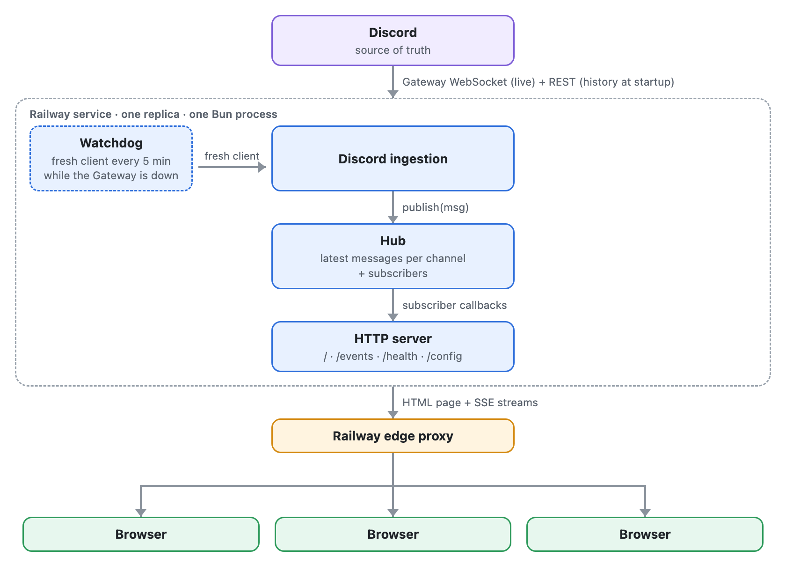
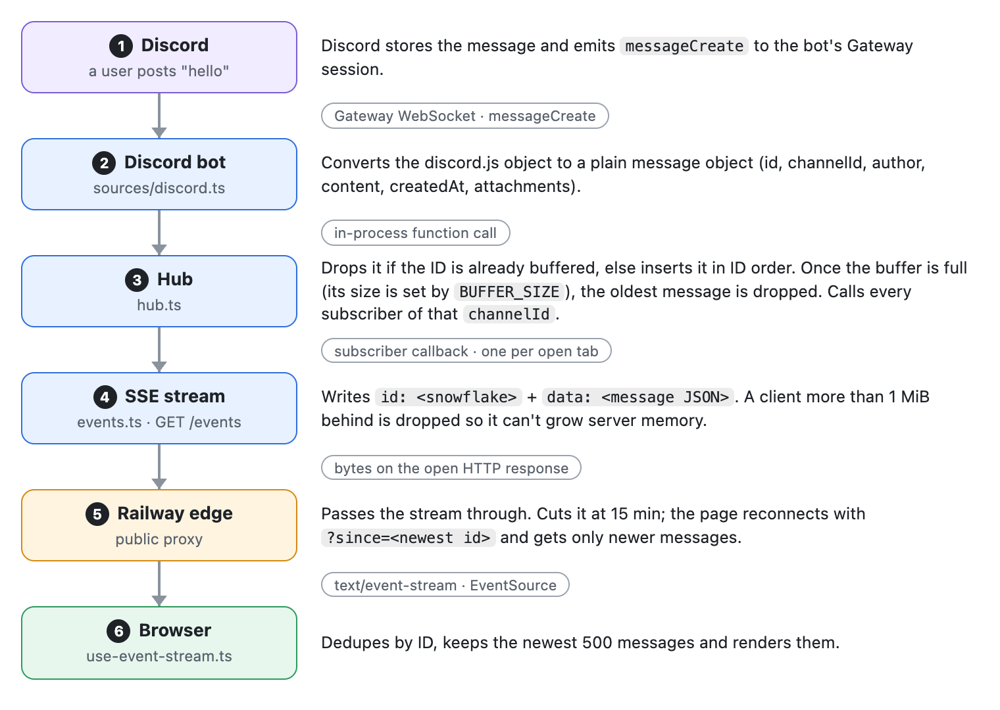
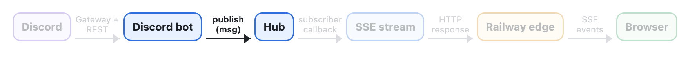
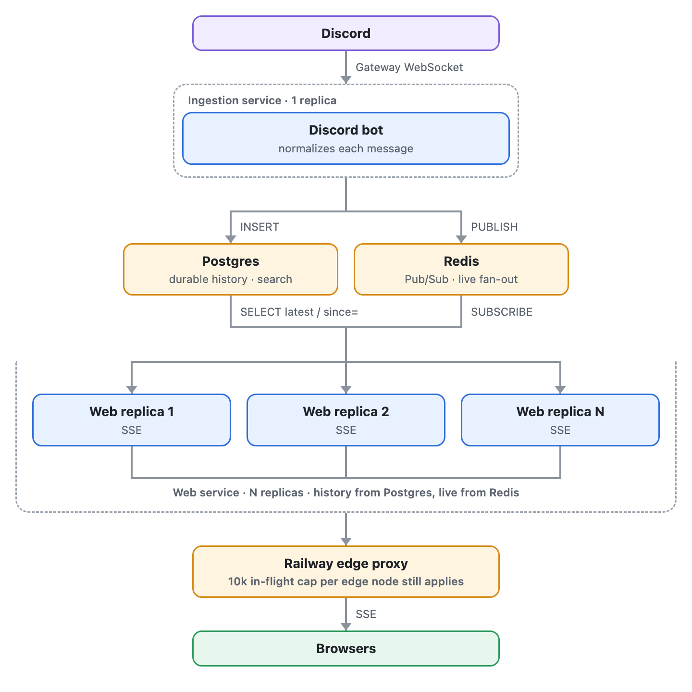

# DiscordRelay

A Discord bot that streams messages from one or more Discord channels into a web page in real time. 

Link: [discord-relay-production-262e.up.railway.app](https://discord-relay-production-262e.up.railway.app)


## Acronyms and Terminology

| Term | Meaning |
| --- | --- |
| Bun | JavaScript runtime with a built-in HTTP server, bundler and test runner. Runs the server, bundles the React page and runs the tests. |
| Gateway | Discord's real-time WebSocket API. The bot gets new and deleted messages through it. |
| Snowflake | Discord's message ID: unique and time-ordered. Used for ordering and dedupe. |
| SSE | Server-Sent Events: a one-way server-to-browser stream over plain HTTP, read with `EventSource`. Served on `GET /events`. |
| Edge | Railway's public proxy. Cuts requests at 15 min and caps in-flight requests per domain. |
| SIGTERM | The signal Railway sends to stop the process. The server closes open streams and the Discord client, then exits. |


## High Level Design

### How it works
One Railway service, with one replica, runs three components in a single Bun process:

- **Discord ingestion**: connects to Discord as a read-only bot, loads recent history over Discord's REST API at startup, and receives new messages live over the gateway (Discord's real-time WebSocket)
  - **Watchdog**: a timer that starts whenever the Gateway connection drops. If the connection is not back within 5 minutes, it replaces the stuck Discord client with a fresh one, and repeats every 5 minutes until one connects. Messages already on the page are kept. Railway only health-checks at deploy time, so without the watchdog a connection that stalls later would go unnoticed
- **Hub**: keeps an in-memory buffer of recent messages per channel. Each open browser stream registers a callback; when a message arrives, the hub calls every callback for that channel
- **HTTP Server**: serves the web page, streams messages to browsers over SSE




### HTTP API

| Route | Returns |
| --- | --- |
| `GET /` | The React page, bundled by Bun. |
| `GET /events?channel=<id>&since=<id>` | An SSE stream: the Discord connection status, then the buffered messages (only those newer than `since`, if given), then new messages as they are posted. |
| `GET /config` | The feature flags and the list of channels with their names. |
| `GET /health` | 200 when the Gateway is connected, 503 otherwise. |


## System

### How one message flows from Discord to a browser



1. **Discord to bot.** A user posts. Discord sends `messageCreate` over the Gateway WebSocket the bot holds open.
2. **Normalize.** The bot converts the discord.js object to a plain object (`id`, `channelId`, `author`, `content`, `note`, `createdAt`, `editedAt`, `attachments`).
3. **Hub.** The hub inserts the message into that channel's buffer, or drops it if the ID is already there. The buffer has a fixed size, configurable with `BUFFER_SIZE` (default 100, max 500); once it is full, the oldest message is dropped to make room. Then the hub calls every subscriber callback for that channel.
4. **SSE write.** Each open `/events` stream is one subscriber. It writes `id: <snowflake>` and `data: <JSON>`. A stream more than 1 MiB behind is dropped, so one slow client cannot grow server memory.
5. **Edge to browser.** The bytes go through Railway's proxy to the browser's `EventSource`.
6. **Render.** The page drops duplicate IDs, keeps the newest 500 messages and renders them.


## Known Problems

The two that matter most: Railway's edge caps public viewers at about 10,000, and adding replicas does not raise that. And one replica is a single point of failure, so a crash means a few seconds of outage followed by every viewer reconnecting at once.

### Availability

#### 1. One replica is a single point of failure

- **Problem**: The whole app runs as one copy on one machine.
- **Impact**: A crash or a deploy drops every viewer at once, for a few seconds.
- **Behavior Today**: Railway restarts the server on failure, the bot reloads recent history from Discord, and every page reconnects on its own after a short random delay.
- **Long Term Fix**: [Alternative A](#a-bot-service-redis-pubsub-and-web-replicas): one bot service, Redis and several web replicas, so losing one replica drops only its share of viewers.

#### 2. A deploy or crash causes a reconnect storm

- **Problem**: When the server goes away, every open page tries to reconnect within the same few seconds.
- **Impact**: The new server gets a burst of connections at once. This was load tested over Railway's private network but never through the public edge.
- **Behavior Today**: Railway runs the old and new server side by side for 30 s during a deploy. Each page waits a random delay before reconnecting (up to 1 s, doubling to 30 s on repeated failures), and sends the newest message ID it holds (`?since=`), so the server sends only what it missed instead of the whole buffer.
- **Long Term Fix**: Close the old server's streams at random times across the draining window instead of all at once, and load test a reconnect storm through the public edge.

### Scale and performance

#### 3. Railway's edge caps the number of viewers

- **Problem**: Railway's public proxy allows at most 10,000 in-flight requests per domain per edge node. Each open page holds one long-lived request.
- **Impact**: Past 10,000 viewers, new visitors get a 502 `too many upstream connections for host`, and that includes loading the page itself.
- **Behavior Today**: Nothing. Adding replicas or upgrading the plan does not raise this limit. The Grafana "Near the edge cap" alarm fires at 8,000 open streams.
- **Long Term Fix**: Switch to WebSockets, which the edge does not count once they are established, or hand fan-out to a managed push service such as Pusher or Ably.

#### 4. One CPU core does all the fan-out

- **Problem**: Every message is written separately to every open page, and Bun runs that work on a single thread, so one CPU core does it all.
- **Impact**: The more messages per second, the fewer viewers one server can hold: 16,300 viewers at 10 msg/s, but only 2,000 at 200 msg/s. At 4,000 viewers and 200 msg/s the server stalled for 33.6 s.
- **Behavior Today**: Each message is turned into bytes once and the same bytes are reused for every viewer. A viewer more than 1 MiB behind is dropped, which protects memory but not CPU.
- **Long Term Fix**:
  - **Batch writes**: today, 200 messages a second means 200 separate writes to each open page. Instead, the server would collect the messages that arrive in a short window (for example 50 ms) and send them to each page as one write. At 200 msg/s that is about 20 writes per page per second instead of 200, in exchange for up to 50 ms of extra delay.
  - **Replicas**: after batching, run several copies of the server ([Alternative A](#a-bot-service-redis-pubsub-and-web-replicas)), so the fan-out is spread across several CPU cores instead of one.

#### 5. Dead connections linger

- **Problem**: A viewer that disappears without closing the connection, such as a phone losing signal, still looks connected to the server.
- **Impact**: Those connections stay subscribed for over 5 minutes, using memory and getting written to. One load test reached 75,896 subscribers, of which only about 50,000 were live.
- **Behavior Today**: The connection is cleaned up when a write to it finally fails.
- **Long Term Fix**: Drop a stream that has not accepted any data for N seconds, or use a shorter TCP keepalive.

#### 6. Bandwidth cost grows with message rate × viewers

- **Problem**: Every message is sent to every viewer, and Railway bills outbound traffic.
- **Impact**: 10,000 viewers at 5 msg/s is about 24 MB/s of billed traffic.
- **Behavior Today**: Reconnecting pages send `?since=`, so the buffer is not sent again on every reconnect.
- **Long Term Fix**: Compress the stream, cap the message rate per channel, or move fan-out to a push service.

#### 7. Images load at full resolution

- **Problem**: Attachments are loaded from Discord as the original file.
- **Impact**: A 25 MB photo costs every viewer 25 MB, even though it is shown 400 px wide.
- **Behavior Today**: Attachments are behind the `attachments` flag.
- **Long Term Fix**: Load a resized version from Discord's media proxy and link to the original.

#### 8. A tab open for days can slow down

- **Problem**: A page left open keeps adding messages.
- **Impact**: The page gets heavier over time.
- **Behavior Today**: The page keeps at most 500 messages and removes the oldest.
- **Long Term Fix**: None needed yet.

### Correctness and data

#### 9. Edits are not relayed

- **Problem**: When someone edits a message in Discord, the page is not updated.
- **Impact**: An edited message keeps its old text on the page, because the hub ignores a message ID it already holds.
- **Behavior Today**: Not built.
- **Long Term Fix**: Let the hub replace a message it already holds, behind the `edits-deletes` flag.

#### 10. Deletes only reach the page with the `edits-deletes` flag on

- **Problem**: Removing deleted messages from the page is behind a feature flag that is off by default.
- **Impact**: With the flag off, a message deleted in Discord stays on the public page until it leaves the buffer or the server restarts.
- **Behavior Today**: The flag exists and is off.
- **Long Term Fix**: Turn the flag on once it has been verified in production.

#### 11. A message deleted while the server restarts stays on pages that were already open

- **Problem**: The server remembers recent deletes only in memory, and tells reconnecting pages about them. If a message is deleted in Discord while the server is restarting, the new server never sees that delete, so it has nothing to tell the pages that were open before the restart.
- **Impact**: Someone who kept the page open through the restart still sees the deleted message until they reload. Anyone who opens the page afterwards does not see it, because the new server loads fresh history from Discord.
- **Behavior Today**: Not handled. A reload fixes it.
- **Long Term Fix**: After reconnecting, have the page check which of its messages are still in the server's buffer, or keep recent deletes somewhere that survives a restart.

#### 12. Messages older than the buffer are skipped on reconnect

- **Problem**: A reconnecting page only gets the messages the server still holds, which is at most `BUFFER_SIZE` per channel.
- **Impact**: A page offline for longer than the buffer covers has a gap, and nothing on the page says so.
- **Behavior Today**: The buffer holds up to 500 messages per channel.
- **Long Term Fix**: Show a "some messages skipped" marker, or load older history from Discord.

### Security and abuse

#### 13. No content moderation

- **Problem**: Everything posted in the channel is shown on a public page.
- **Impact**: Offensive content is relayed live.
- **Behavior Today**: Discord AutoMod can block it in Discord before the bot sees it.
- **Long Term Fix**: A filter in front of the hub, with a word list or a moderation API.

#### 14. The per-IP connection cap is blunt

- **Problem**: Each IP address may open at most 20 streams.
- **Impact**: A large office or a network where many people share one IP can be blocked, while an attacker with many IPs (a botnet, an IPv6 range) gets past it.
- **Behavior Today**: The 21st stream gets 429 Too Many Requests with a `Retry-After` header, and the page shows "Connection limit" and waits.
- **Long Term Fix**: Rate limiting at the edge or a CDN/WAF in front, plus a cap on total streams.


## Failure Modes

Each section follows one hop of a message's path and lists what can go wrong there, what a viewer sees, how we find out, and what the app does about it.

### Discord to bot (Gateway)


#### 1. The Gateway connection drops briefly

- **Failure**: The bot's connection to Discord drops for a moment, for example when Discord restarts a server or the network blips.
- **User Sees**: Nothing, or a short pause in new messages.
- **Detection**: `gateway_disconnected` and `gateway_reconnecting` logs.
- **Handling**: discord.js reconnects on its own. If Discord lets it resume the session, Discord replays the missed messages. If not, the bot reloads the latest messages from Discord, and the ones it already had are ignored.

#### 2. The Gateway stays down (the watchdog)

- **Failure**: The connection does not come back, while the server itself keeps running. discord.js can get stuck retrying.
- **User Sees**: An amber "Waiting for Discord" chip and no new messages. Messages already on the page stay.
- **Detection**: `/health` returns 503, the `watchdog_expired` log, and the Grafana "Discord Gateway down" alarm after 2 minutes.
- **Handling**: The watchdog notices the connection has been down for 5 minutes, throws away the stuck Discord client and builds a fresh one, and repeats every 5 minutes until one connects. The buffer is kept, so the page keeps its messages.

#### 3. The bot token is invalid or revoked

- **Failure**: Discord rejects the bot's token, for example because it was reset in the Discord developer portal.
- **User Sees**: A red "Relay down" chip and "The relay cannot sign in to Discord. The project maintainer has been notified."
- **Detection**: The `discord_login_failed` error log, `/health` returns 503, and the Grafana "Discord Gateway down" alarm posts to the maintainer's Discord channel within 2 minutes.
- **Handling**: The server stays up instead of crashing and restarting, and tells every open page. A new deploy with a bad token fails Railway's healthcheck, so the previous deploy keeps serving. The fix is to set a valid `DISCORD_TOKEN`, which redeploys.

#### 4. A channel's history cannot be loaded

- **Failure**: At startup the bot loads each channel's recent messages from Discord. This fails if Discord is down, rate-limits the bot, or the bot lacks permission to read the channel.
- **User Sees**: An empty or partial page and a "Channel unavailable" chip.
- **Detection**: The `history_failed` log, and the channel listed under `unavailableChannels` in `/health`.
- **Handling**: The bot retries that channel, waiting longer each time (5 s, doubling up to 5 minutes), until it loads.

### Bot to hub (inside the server)



The bot and the hub run in the same server, so this hop is a function call, not a network connection. What can go wrong here is bad or repeated data.

#### 5. A message cannot be converted

- **Failure**: An unusual Discord message makes the conversion into the app's message format fail.
- **User Sees**: That one message is missing.
- **Detection**: The `message_skipped` error log.
- **Handling**: The bot skips that message and keeps relaying. Without this, one bad message would crash the server.

#### 6. The same message arrives twice

- **Failure**: After a reconnect the bot reloads recent history, which overlaps with messages it already received live.
- **User Sees**: Nothing.
- **Detection**: None needed.
- **Handling**: The hub keeps one copy per message ID, and so does the page.

#### 7. Sending to one page fails

- **Failure**: The hub hands each new message to every open page in turn, and an error happens while sending to one of them.
- **User Sees**: Nothing on the other pages.
- **Detection**: The `subscriber_failed` log.
- **Handling**: Each page is handled separately, so one failure does not stop the message reaching the others.

### Hub to browser (through Railway's edge)


#### 8. Railway cuts every connection after 15 minutes

- **Failure**: Railway's proxy ends any request after 15 minutes, and a page's stream is one long request.
- **User Sees**: A brief "Reconnecting…".
- **Detection**: The page's `EventSource` reports an error.
- **Handling**: The page reconnects after a short random delay and sends the newest message ID it holds, so the server sends only what it missed.

#### 9. Railway closes a connection that has been silent for 5 minutes

- **Failure**: A quiet channel can go many minutes without a message. Railway's proxy treats a connection with no traffic for 5 minutes as dead and closes it.
- **User Sees**: Nothing.
- **Detection**: None needed.
- **Handling**: The server sends a tiny `ping` event every 25 s, so the connection is never silent. The page also uses the pings to notice a dead connection: after 60 s without one, it reconnects.

#### 10. The browser loses its network or the laptop sleeps

- **Failure**: The connection dies on the viewer's side.
- **User Sees**: "Reconnecting…", then the missed messages appear.
- **Detection**: The page's error event, or 60 s without a ping.
- **Handling**: The page retries with a growing wait (up to 1 s at first, doubling to 30 s) and asks only for messages newer than the ones it holds. Messages older than the server's buffer are skipped.

#### 11. A viewer cannot keep up

- **Failure**: A viewer on a slow connection reads more slowly than messages arrive, so unsent messages pile up in server memory.
- **User Sees**: That page reconnects and catches up.
- **Detection**: The `client_dropped` warn log and the Grafana "Drop spike" alarm.
- **Handling**: Once 1 MiB is waiting for one viewer, the server drops that stream, so one slow viewer cannot grow server memory.

#### 12. One machine opens many streams

- **Failure**: One IP address opens many streams, by accident (many tabs) or on purpose.
- **User Sees**: "Connection limit" on that machine.
- **Detection**: HTTP 429 in Railway's logs and `relay_rejected_total` in Grafana.
- **Handling**: At most 20 streams per IP. The 21st gets 429 with a `Retry-After` header and the page waits that long. Many IPs (a botnet, an IPv6 range) get past it.

#### 13. More viewers than Railway's edge allows

- **Failure**: More than 10,000 in-flight requests per edge node (see [Known Problem 3](#3-railways-edge-caps-the-number-of-viewers)).
- **User Sees**: New visitors cannot load the page (502 `too many upstream connections for host`).
- **Detection**: Railway's HTTP logs and the Grafana "Near the edge cap" alarm at 8,000 streams.
- **Handling**: Nothing yet. Replicas do not raise this limit.

#### 14. Viewers vanish without closing the connection

- **Failure**: A phone loses signal without closing its stream, so the server still counts it as connected.
- **User Sees**: Nothing, but the stream holds server memory.
- **Detection**: The viewer count in `/health` and Grafana stays high.
- **Handling**: The stream is freed when a write to it fails.

#### 15. A message carries a malicious attachment link

- **Failure**: A message includes an attachment URL that points somewhere other than Discord.
- **User Sees**: Nothing.
- **Detection**: None needed.
- **Handling**: The page only renders attachments hosted on Discord's CDN.

### Server and Railway

Failures of the server program itself (the running copy of the app, also called the process) or of Railway deploying and running it.

#### 16. The server crashes

- **Failure**: An unexpected error stops the server.
- **User Sees**: "Reconnecting…" for a few seconds.
- **Detection**: The `unhandled_error` log, and the Grafana "App down" alarm if it stays down for 3 minutes.
- **Handling**: Railway restarts it, the bot reloads recent history from Discord, and every page reconnects on its own.

#### 17. An environment variable is missing or invalid

- **Failure**: A required setting such as `CHANNEL_ID` is missing or malformed.
- **User Sees**: Nothing; the new deploy never goes live and the previous one keeps serving.
- **Detection**: The `config_invalid` log, naming the variable.
- **Handling**: The server exits at startup instead of running half-configured.

#### 18. A deploy drops every viewer at once

- **Failure**: A deploy replaces the running server, which ends every open stream.
- **User Sees**: Up to about 1 s of "Reconnecting…".
- **Detection**: The viewer count in `/health` and Grafana.
- **Handling**: Railway runs the old and new server side by side for 30 s, then sends the old one SIGTERM. The old server closes its streams cleanly, and each page reconnects after its own random delay, so they do not all arrive at once.

#### 19. Railway health-checks only at deploy time

- **Failure**: Railway checks `/health` when a deploy starts, but not afterwards, so a server that breaks later stays live.
- **User Sees**: Depends on what broke.
- **Detection**: The Grafana alarms: "App down", "Discord Gateway down" and "HTTP 500 errors".
- **Handling**: The watchdog fixes the one known way the server stalls (a stuck Gateway connection).


## Alternatives Considered

Both alternatives solve the same problem: running more than one web replica. In the current design, every extra replica would start its own bot with its own buffer.

### A. Bot service, Redis Pub/Sub and web replicas


One bot publishes each message to Redis. Every web replica subscribes and fans messages out to its own SSE clients. The buffer for new visitors lives in Redis (a capped list or a Stream) or is rebuilt in each replica. `publish` and `subscribe` keep their signatures, so only `hub.ts` changes.

Why it isn't built yet:

- More replicas would not let more people in. Railway's edge caps a domain at 10,000 in-flight requests per edge node, counted across all replicas, and each SSE stream is a long-lived request. The public load test hit that cap at about 15,000 clients, while one replica held 16,300 clients at 10 msg/s over the private network.
- One replica covers the load we expect. It held 55,000 clients at 1 msg/s over the private network.
- Redis adds a service, a bill, a network hop and a new way to fail: if Redis is down, no messages get through. Pub/Sub also drops messages for a subscriber that is disconnected, so the replicas would need their own reconnect and replay logic.
- A crash already recovers in a few seconds, through restart on failure and a history refetch. At this size that is enough for the single point of failure.

Build it when a few seconds of downtime on a crash stops being acceptable, when one CPU core becomes the limit, or once WebSockets or a push service get past the edge cap.

### B. Postgres for storage, Redis for fan-out



The bot writes every message to Postgres and publishes it to Redis. Web replicas read history and `?since=` replays from Postgres, and live messages from Redis.

Why it wasn't chosen:

- Discord already stores every message. A second copy brings sync problems (edits, deletes, events missed during downtime) and does nothing for someone watching live.
- Nothing in the product needs search or history beyond 500 messages yet.
- It costs the most of the three options and takes the most work to run: two stateful services, migrations and backups.
- SQLite on a Railway volume was ruled out separately, because volumes cannot be used with replicas.

Build it for search, history beyond 500 messages, many channels, or many replicas all calling Discord's REST API at startup.

### Other options

| Option | Why not |
| --- | --- |
| A bot in every replica, no Redis | It works because the bot only reads, but each replica keeps its own buffer and its own Gateway session |
| WebSockets instead of SSE | Two-way, which we don't need. They are exempt from the 15-minute cut, so they are worth another look for the edge cap |
| Polling | More lag and more requests |
| A managed push service (Pusher, Ably) | The way past the edge cap, at the cost of a bill and a vendor |


## Load Testing

The question was how many viewers one server can hold for one busy channel. Every message is written once per open stream, so the server's work is rate × viewers. Discord rate-limits posting, which keeps inbound volume low, so fan-out to viewers is the axis to test.


- **Harness:** `load-tests/` in this repo. `run.ts` ramps consumer counts, `max.ts` narrows down to the limit and repeats it, `verdict.ts` judges each step, `agent.ts` coordinates several consumer machines and `railway-metrics.ts` adds Railway's CPU and memory figures.
- **Setup:** the real `discord-relay` service, in a temporary build with one extra private port for the generator and stats. The consumers and the generator ran on Railway over the private network. The app was restarted, with a 2-minute wait, before each test.
- **Fixed settings:** one channel, 456-byte messages, `BUFFER_SIZE` 100 and a 60 s hold per step.
- **Verdicts:** PASS means every message reached every consumer, none were dropped, p99 was at most 1 s and the slowest delivery at most 5 s. SLOW means nothing was lost but p99 or the slowest delivery was over those limits. BROKEN means a message was lost or a consumer was dropped or refused. INVALID means the test rig itself was saturated, so the step needs re-running with more capacity.
- **Usable Max** is the highest count that passes 3 runs out of 3. **Hard Max** is the highest count before BROKEN.
- A separate run went through the public URL to find the limit of Railway's edge.

The numbers are in [Appendix G: Load test results](#g-load-test-results).


## Observability

Railway's Hobby plan has no custom metrics, dashboards or alerts, so the app sends its own numbers to Grafana Cloud's free tier. Every 60 seconds it pushes one line of metrics over HTTPS. Nothing new is served or shown on the page, and a failed push is logged and does not affect the relay. CPU and memory stay in Railway's own metrics.

### Metrics

| Metric | What it counts |
| --- | --- |
| `relay_gateway_connected` | 1 while the bot is connected to Discord, 0 otherwise |
| `relay_sse_clients` | Open browser streams |
| `relay_messages_total` | Messages relayed |
| `relay_clients_dropped_total` | Clients dropped for falling 1 MiB behind |
| `relay_rejected_total` | Streams refused with 429 by the per-IP cap |
| `relay_watchdog_restarts_total` | Fresh Discord clients started after a long Gateway outage |
| `relay_http_errors_total` | 500s from a route that threw |

Each line carries a `deployment` tag, so the old and new process keep separate totals while they overlap during a deploy.

### Dashboard

[One Grafana dashboard](https://earnestturkey2621.grafana.net/public-dashboards/43657ad697154903aa9ed639ef2eaaf1), public and read-only, with a panel per metric: Gateway status, viewers, messages per second, 500s, clients dropped, 429s and watchdog restarts.


### Alarms

Alarms post to a private Discord channel.

| Alarm | Fires when |
| --- | --- |
| App down | No metrics arrive for 3 minutes |
| Discord Gateway down | The bot stays disconnected for 2 minutes |
| HTTP 500 errors | Any 500 in 5 minutes |
| Near the edge cap | More than 8,000 open streams for 5 minutes |
| Drop spike | More than 1% of clients dropped in 5 minutes |

The dashboard and alarms are code in `.grafana/apply.ts`. Running it again updates them in place.


## Appendix

### A. Message shape

```json
{
  "id": "1566588496691400001",
  "channelId": "1566584977829900002",
  "author": { "id": "961675715634400003", "name": "relay_tester", "avatarUrl": "https://cdn.discordapp.com/embed/avatars/0.png", "bot": false },
  "content": "Hello from Relay Channel",
  "note": null,
  "createdAt": "2026-11-01T23:03:23.418Z",
  "editedAt": null,
  "attachments": []
}
```

### B. SSE wire format

```txt
: connected

event: discord
data: connected

id: 1301234567890123456
data: {"id":"1301234567890123456","channelId":"…","content":"hello",…}

event: delete
data: {"id":"1301234567890123456","channelId":"…"}

event: ping
data: 1
```

### C. Configuration

| Variable | Required | Purpose |
| --- | --- | --- |
| `DISCORD_TOKEN` | yes | Bot token, as a sealed Railway variable |
| `CHANNEL_ID` | yes | One or more channel IDs, comma-separated |
| `BUFFER_SIZE` | no (100) | Messages kept per channel, 1 to 500 |
| `LOG_LEVEL` | no | `debug` logs every client connect and disconnect |
| `RAILWAY_TOKEN` | no | Reads the feature flags; without it every flag is off |
| `PORT` | injected | Set by Railway |

### D. Limits

| Limit | Value |
| --- | --- |
| Server buffer per channel | `BUFFER_SIZE`, default 100, max 500 |
| Browser message cap | 500 |
| Open streams per IP | 20, then 429 |
| Queued bytes per stream | 1 MiB, then dropped |
| Reconnect delay | Random, up to 1 s, doubling to 30 s |
| SSE heartbeat | 25 s |
| Gateway watchdog | Every 5 min while disconnected |

### E. Decision log

| Decision | Main reason |
| --- | --- |
| SSE to the browser | One-way data, plain HTTP, built-in reconnect |
| Bun | Server, bundler and tests built in |
| One service for backend and frontend | One deploy, one domain, no CORS |
| React + MUI | A fast, accessible UI that escapes text |
| No database | Discord already stores everything |
| One replica | Extra replicas mean extra bots and buffers |
| Reconnect with `?since=` | Avoids resending about 58 KB per client every 15 min |
| Railway Feature Flags | Changes without a redeploy |
| Railway IaC | `railway.json` is deprecated |
| No staging | Tests cover the logic, and the team is small |
| Gateway watchdog | Healthchecks only run at deploy time |
| No moderation filter | Discord AutoMod comes first |
| Extensibility through `channelId` | Redis can replace the hub behind the same two functions |

### F. Repo references

- `docs/system-specs/architecture.md`, `decisions.md`, `failure-modes.md`, `message-shape.md`
- `docs/load_test_plan.md`, `docs/load_test_results.md`, `docs/load_test_results_Nov_04.md`
- `load-tests/` (harness), `.railway/railway.ts` (IaC), `.railway/flags.sh` (flags)

### G. Load test results

**Summary (Nov 4, private network)**

| Rate | Usable Max | First SLOW | Hard Max |
| --- | --- | --- | --- |
| 1 msg/s | ≥ 55,000 (top of the test, 1 run) | Not reached | Not reached |
| 10 msg/s | **16,300** (3 of 3 repeats) | 17,500 | Not reached by 20,000 |
| 50 msg/s | ≥ 5,000 (1 run) | 7,500 | Not reached by 7,500 |
| 200 msg/s | 2,000 (2 of 2 runs) | 2,500 | **Between 3,000 and 4,000** |

**10 msg/s, narrowing the Usable Max**

| Consumers | Result | Delivered | p50 | p99 | Slowest | CPU (one core) | Memory |
| --- | --- | --- | --- | --- | --- | --- | --- |
| 10,000 | PASS | 100% | 221 ms | 327 ms | 427 ms | 92% | 617 MB |
| 15,000 | PASS | 100% | 365 ms | 585 ms | 794 ms | 92% | 888 MB |
| 16,300 (×4) | PASS | 100% | 595–644 ms | 894–948 ms | 1,064–1,161 ms | 92% | about 990 MB |
| 17,500 | SLOW | 100% | 722 ms | 1,094 ms | 1,396 ms | 92% | 1,082 MB |
| 20,000 | SLOW | 100% | 840 ms | 1,315 ms | 1,575 ms | 92% | 1,188 MB |

**50 msg/s**

| Consumers | Result | p50 | p99 | Slowest | CPU | Memory |
| --- | --- | --- | --- | --- | --- | --- |
| 1,000 | PASS | 8 ms | 20 ms | 211 ms | 49% | 117 MB |
| 2,500 | PASS | 48 ms | 78 ms | 263 ms | 92% | 202 MB |
| 5,000 | PASS | 185 ms | 307 ms | 388 ms | 95% | 347 MB |
| 7,500 | SLOW | 1,141 ms | 1,613 ms | 1,812 ms | 95% | 509 MB |

**200 msg/s**

| Consumers | Result | p50 | p99 | Slowest | CPU | Memory |
| --- | --- | --- | --- | --- | --- | --- |
| 500 | PASS | 7 ms | 19 ms | 128 ms | 78% | 73 MB |
| 1,000 | PASS | 22 ms | 44 ms | 109 ms | 91% | 108 MB |
| 2,000 | PASS | 548–577 ms | 766–840 ms | 864–986 ms | 93% | 167–185 MB |
| 2,500 | SLOW | 825 ms | 1,134 ms | 1,640 ms | 92% | 211 MB |
| 3,000 | SLOW | 875 ms | 1,226 ms | 1,484 ms | 90% | 242 MB |
| 4,000 | **BROKEN** | n/a | n/a | n/a | 96% | 1,384 MB |

At 4,000 consumers the event loop stalled for up to 33.6 s, and the app dropped about 2,370 consumers for falling 1 MiB behind, which is the safety limit doing its job. The app did not crash and the bot stayed connected.

**1 msg/s**

| Consumers | Result | p50 | p99 | Slowest | CPU | Memory |
| --- | --- | --- | --- | --- | --- | --- |
| 10,000 | PASS | 67 ms | 123 ms | 138 ms | 11% | 629 MB |
| 30,000 | PASS | 194 ms | 367 ms | 423 ms | 34% | 1,743 MB |
| 55,000 | PASS | 369 ms | 789 ms | 975 ms | 61% | 3,122 MB |

**Public URL, through Railway's edge (Nov 3, 5 msg/s, live bot)**

| Clients | Delivered | p50 | p99 | Slowest | Memory | Result |
| --- | --- | --- | --- | --- | --- | --- |
| 5,001 | 100% | 53 ms | 87 ms | 0.9 s | 419 MB | Pass |
| 10,002 | 100% | 88 ms | 160 ms | 0.7 s | 677 MB | Pass |
| 12,000 | 100% | 101 ms | 348 ms | 0.8 s | 811 MB | Pass |
| 15,000 | 100% | 121 ms | 420 ms | 5.9 s | 872 MB | Pass in one clean run |
| 15,000 (earlier run) | n/a | n/a | n/a | n/a | n/a | Fail: 5,500 attempts got 502 `too many upstream connections for host` from the edge |

**What the numbers say**

- Below the Hard Max nothing was lost. Under load, delivery got slower but stayed complete.
- One CPU core is the bottleneck. Bun runs this on one thread, and CPU sat at about 92% of one core near every limit while Railway showed at most 1.2 of 8 vCPU in use.
- Memory is not the limit: about 60 KB per consumer, or 3.1 GB at 55,000.
- The edge caps public reach at roughly 12,000 to 15,000 connections, well below what the server can hold, and adding replicas would not raise it.
- The tests did not cover long holds (steps were 60 s), real browsers, larger messages or the bot handling real traffic.
