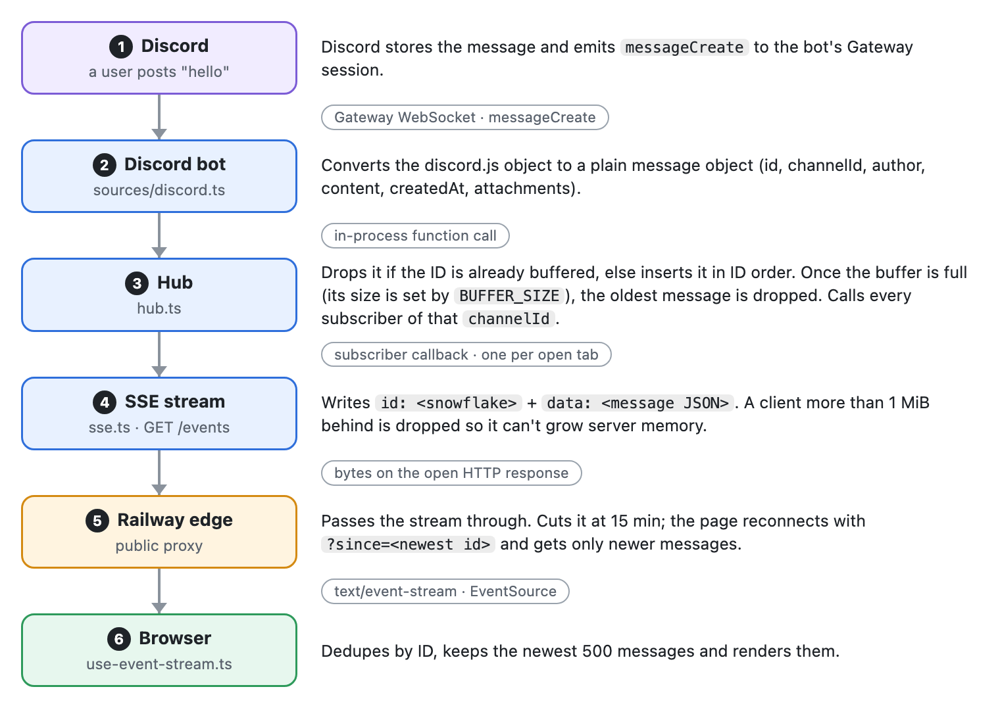
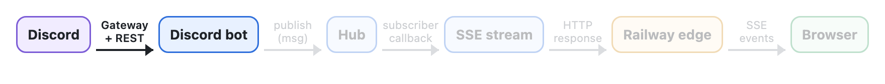
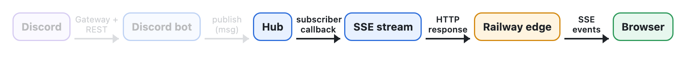
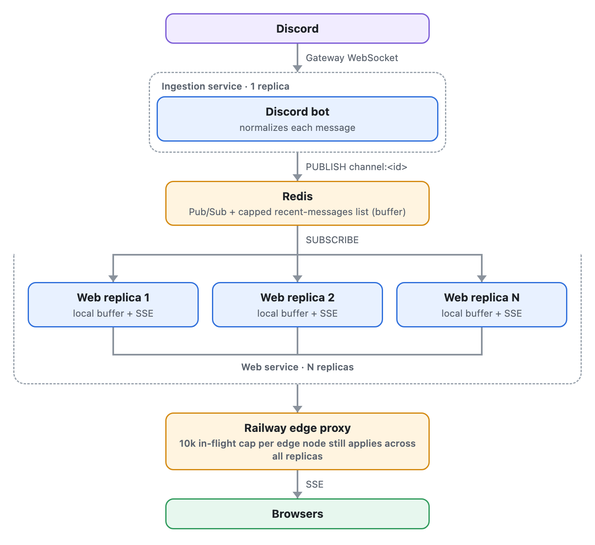
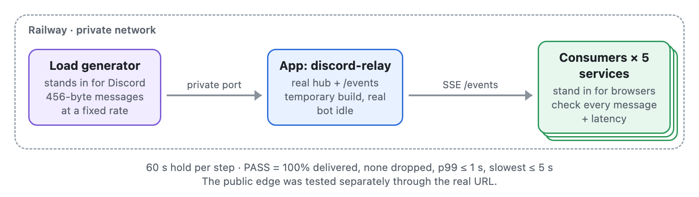
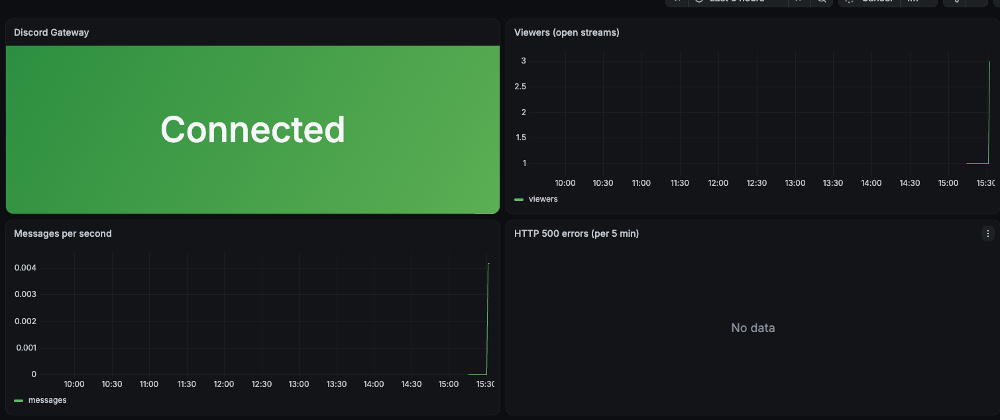

# DiscordRelay

A Discord bot that streams messages from one or more Discord channels into a web page in real time. 

Link: [discord-relay-production-262e.up.railway.app](https://discord-relay-production-262e.up.railway.app)


## High Level Design

### How it works
One Railway service, with one replica, runs three components in a single Bun process:

- **Discord ingestion**: connects to Discord as a read-only bot, loads recent history over Discord's REST API (Representational State Transfer Application Programming Interface) at startup, and receives new messages live over the gateway (Discord's real-time WebSocket)
  - **Watchdog**: a timer that starts whenever the Gateway connection drops. If the connection is not back within 5 minutes, it replaces the stuck Discord client with a fresh one, and repeats every 5 minutes until one connects. Messages already on the web page are kept. Railway only health-checks at deploy time, so without the watchdog a connection that stalls later would go unnoticed
- **Hub**: keeps an in-memory buffer of recent messages per channel. It is a `Map` keyed by `channelId`, and everything in it lives under that key, so channels never mix: the buffer, the subscribers and the IDs (identifiers) of deleted messages. Each open web page subscribes to one channel. The Discord bot publishes each new message to the hub, and the hub passes it to every subscriber of that channel. How the buffer is laid out is in [Appendix G](#g-the-hubs-buffer)
- **HTTP Server**: serves the web page over HTTP (Hypertext Transfer Protocol) and streams messages to browsers over SSE (Server-Sent Events)


### HTTP API

| Route | Returns |
| --- | --- |
| `GET /` | The React web page, bundled by Bun. |
| `GET /events?channel=<id>&since=<id>` | An SSE stream: the Discord connection status, then the buffered messages (only those newer than `since`, if given), then new messages as they are posted. |
| `GET /config` | The feature flags and the list of channels with their names. |
| `GET /health` | 200 when the Gateway is connected, 503 otherwise. |


## System

### How one message flows from Discord to a browser



1. **Discord to bot:** A user posts. Discord sends `messageCreate` over the Gateway WebSocket the bot holds open.
2. **Normalize:** The bot converts the discord.js object to a plain object (`id`, `channelId`, `author`, `content`, `note`, `createdAt`, `editedAt`, `attachments`).
3. **Hub:** The hub inserts the message into that channel's buffer, or drops it if the ID is already there. The buffer has a fixed size, configurable with `BUFFER_SIZE` (default 100, max 500); once it is full, the oldest message is dropped to make room. Then the hub calls every subscriber callback for that channel.
4. **SSE write:** Each open `/events` stream is one subscriber. It writes `id: <snowflake>` and `data: <JSON>`. A stream more than 1 MiB behind is dropped, so one slow client cannot grow server memory. What "behind" means is in [Appendix I](#i-from-stream-to-browser-queues-sockets-and-buffers).
5. **Edge to browser:** The bytes go through Railway's proxy to the browser's `EventSource`.
6. **Render:** The web page drops duplicate IDs, keeps the newest 500 messages and renders them.


## Failure Modes

Each section follows one hop of a message's path and lists what can go wrong there, what a viewer sees, how we find out, and what the app does about it.

### Discord to bot (Gateway)



#### 1. The Gateway connection drops briefly

- **Failure**: The bot's connection to Discord drops for a moment, for example when Discord restarts a server or the network blips.
- **User Sees**: A short amber "Waiting for Discord" chip, then the messages posted during the drop appear together.
- **Detection**: The server logs each disconnect and reconnect.
- **Handling**: discord.js reconnects on its own and asks Discord to resume the session. If Discord still has it, Discord resends every event the bot missed, deletes included. If not, discord.js starts a new session, and the bot reloads each channel's latest messages over Discord's REST API (up to `BUFFER_SIZE`). The hub ignores the ones it already has. Messages older than that are not recovered.

#### 2. The Gateway stays down (the watchdog)

- **Failure**: The connection does not come back, while the server itself keeps running. discord.js can get stuck retrying.
- **User Sees**: An amber "Waiting for Discord" chip and no new messages. Messages already on the web page stay.
- **Detection**: Grafana's "Discord Gateway down" alarm goes off after 2 minutes. The logs show `gateway_disconnected` at once and `watchdog_expired` when the watchdog steps in at 5 minutes.
- **Handling**: The watchdog notices the connection has been down for 5 minutes, throws away the stuck Discord client and builds a fresh one, and repeats every 5 minutes until one connects. The buffer is kept, so the web page keeps its messages.

#### 3. The bot token is invalid or revoked

- **Failure**: Discord rejects the bot's token, for example because it was reset in the Discord developer portal.
- **User Sees**: A red "Relay down" chip and "The relay cannot sign in to Discord. The project maintainer has been notified."
- **Detection**: The server logs that Discord refused the login, and within 2 minutes Grafana's "Discord Gateway down" alarm posts to the maintainer's Discord channel.
- **Handling**: The server stays up instead of crashing and restarting, and tells every open web page. A new deploy with a bad token fails Railway's healthcheck, so the previous deploy keeps serving. The fix is to set a valid `DISCORD_TOKEN`, which redeploys.

#### 4. A channel's history cannot be loaded

- **Failure**: At startup the bot loads each channel's recent messages from Discord. This fails if Discord is down, rate-limits the bot, or the bot lacks permission to read the channel.
- **User Sees**: An empty or partial web page and a "Channel unavailable" chip.
- **Detection**: The server logs the failure. No alarm covers this yet.
- **Handling**: The bot retries that channel, waiting longer each time (5 s, doubling up to 5 minutes), until it loads.

### Bot to hub (inside the server)


The bot and the hub run in the same server, so this hop is a function call, not a network connection. What can go wrong here is bad or repeated data.

#### 5. A Discord message cannot be turned into the app's message format

- **Failure**: Before a message reaches the hub, the bot turns the discord.js message object into the app's own plain message (ID, author, text, attachments, timestamps; see [Appendix A](#a-message-shape)). An unusual Discord message can make that step throw.
- **User Sees**: That one message is missing.
- **Detection**: The server logs an error for each skipped message.
- **Handling**: The bot skips that message and keeps relaying. Without this, one bad message would crash the server.

#### 6. The same message arrives twice

- **Failure**: After a reconnect the bot reloads recent history, which overlaps with messages it already received live.
- **User Sees**: Nothing.
- **Detection**: None needed.
- **Handling**: The hub keeps one copy per message ID, and so does the web page.

### Hub to browser (through Railway's edge)



#### 7. Railway cuts every connection after 15 minutes

- **Failure**: Railway's proxy ends any request after 15 minutes, and a web page's stream is one long request.
- **User Sees**: A brief "Reconnecting…".
- **Detection**: The web page notices its stream has closed.
- **Handling**: The web page reconnects after a short random delay and sends the newest message ID it holds, so the server sends only what it missed.
  - The web page keeps that ID in memory, in a plain variable that every arriving message updates. Nothing goes into cookies or browser storage. On reconnect it calls `/events?channel=<id>&since=<newest id>`. A reload or a new tab starts with no ID and gets the whole buffer.
  - `EventSource` has a built-in version of this: when it reconnects on its own, it sends the last `id:` it received as a `Last-Event-ID` header. The web page cannot use it. The built-in reconnect waits a fixed few seconds and gives up for good on an HTTP error, such as a 502 during a deploy. So on any error the web page closes its `EventSource` and later creates a new one, after its own random, growing delay. The remembered ID belongs to the old object, a new one starts empty, and `EventSource` does not let a web page set headers itself. Putting the ID in the URL works around all of that.

#### 8. Railway closes a connection that has been silent for 5 minutes

- **Failure**: A quiet channel can go many minutes without a message. Railway's proxy treats a connection with no traffic for 5 minutes as dead and closes it.
- **User Sees**: Nothing.
- **Detection**: None needed.
- **Handling**: The server sends a tiny `ping` event every 25 s, so the connection is never silent. The web page also uses the pings to notice a dead connection: after 60 s without one, it reconnects.

#### 9. The browser loses its network or the laptop sleeps

- **Failure**: The connection dies on the viewer's side.
- **User Sees**: "Reconnecting…", then the missed messages appear.
- **Detection**: The web page notices its stream has closed, or that no ping has arrived for 60 s.
- **Handling**: The web page retries with a growing wait (up to 1 s at first, doubling to 30 s) and asks only for messages newer than the ones it holds. Messages older than the server's buffer are skipped.

#### 10. A viewer cannot keep up

- **Failure**: A viewer on a slow connection reads more slowly than messages arrive, so unsent messages pile up in server memory.
- **User Sees**: That web page reconnects and catches up.
- **Detection**: The server logs a warning for each dropped viewer, and Grafana's "Drop spike" alarm goes off if more than 1% are dropped in 5 minutes.
- **Handling**: Once 1 MiB is waiting for one viewer, the server drops that stream, so one slow viewer cannot grow server memory. The web page sees its stream end and reconnects like after any other drop: after a random delay, with the newest message ID it holds, so the server replays what it missed from the buffer. A viewer that stays too slow is dropped again, and its reconnect delays grow up to 30 s. [Appendix I](#i-from-stream-to-browser-queues-sockets-and-buffers) shows where those bytes wait.

#### 11. One machine opens many streams

- **Failure**: One IP (Internet Protocol) address opens many streams, by accident (many tabs) or on purpose.
- **User Sees**: "Connection limit" on that machine.
- **Detection**: Railway's logs show the refused requests (HTTP 429), and Grafana counts them.
- **Handling**: At most 20 streams per IP. The 21st gets 429 with a `Retry-After` header and the web page waits that long.

#### 12. More viewers than Railway's edge allows

- **Failure**: More than 10,000 in-flight requests per edge node (see [Known Problem 3](#3-railways-edge-caps-the-number-of-viewers)).
- **User Sees**: New visitors cannot load the web page (502 `too many upstream connections for host`).
- **Detection**: Railway's logs show the refused requests, and Grafana's "Near the edge cap" alarm goes off at 8,000 open streams.
- **Handling**: Nothing yet. Replicas do not raise this limit.

#### 13. Viewers vanish without closing the connection

- **Failure**: A phone loses signal without closing its stream, so the server still counts it as connected.
- **User Sees**: Nothing, but the stream holds server memory.
- **Detection**: Not detected directly. Grafana's viewer count includes these streams and cannot tell them apart from live ones.
- **Handling**: Nothing actively. The server frees the stream when its connection closes: when Railway's edge gives up on the phone, or at the 15-minute cut at the latest. In a busy channel the 1 MiB limit can drop it sooner.

#### 14. A message carries a malicious attachment link

- **Failure**: A message includes an attachment URL (Uniform Resource Locator) that points somewhere other than Discord.
- **User Sees**: Nothing.
- **Detection**: None needed.
- **Handling**: The web page only renders attachments hosted on Discord's CDN (Content Delivery Network).

### Server and Railway

Failures of the server program itself (the running copy of the app, also called the process) or of Railway deploying and running it.

#### 15. The server crashes

- **Failure**: An unexpected error stops the server.
- **User Sees**: "Reconnecting…" for a few seconds.
- **Detection**: The server logs the error, and Grafana's "App down" alarm goes off if it stays down for 3 minutes.
- **Handling**: Railway restarts it, the bot reloads recent history from Discord, and every web page reconnects on its own. If every restart crashes again, Grafana's "App down" alarm posts to the maintainer's Discord channel once no metrics have arrived for 3 minutes. Railway stops after 10 restarts, so the maintainer rolls back to the previous deployment in Railway and reads `@event:unhandled_error` in the logs for the stack trace.

#### 16. An environment variable is missing or invalid

- **Failure**: A required setting such as `CHANNEL_ID` is missing or malformed.
- **User Sees**: Nothing; the new deploy never goes live and the previous one keeps serving.
- **Detection**: The server logs which variable is missing or wrong.
- **Handling**: The server exits at startup instead of running half-configured.

#### 17. A deploy drops every viewer at once

- **Failure**: A deploy replaces the running server, which ends every open stream.
- **User Sees**: Up to about 1 s of "Reconnecting…".
- **Detection**: Railway shows the deploy, and the viewer count in Grafana shows web pages reconnecting.
- **Handling**: Railway runs the old and new server side by side for 30 s, then sends the old one SIGTERM (the signal asking a process to terminate). The old server closes its streams cleanly, and each web page reconnects after its own random delay, so they do not all arrive at once.


## Known Problems

### Availability

#### 1. One replica is a single point of failure

- **Problem**: The whole app runs as one copy on one machine.
- **Impact**: A crash or a deploy drops every viewer at once, for a few seconds.
- **Behavior Today**: Railway restarts the server on failure, the bot reloads recent history from Discord, and every web page reconnects on its own after a short random delay.
- **Long Term Fix**: [Alternative A](#a-bot-service-redis-pubsub-and-web-replicas): one bot service, Redis and several web replicas, so losing one replica drops only its share of viewers.

#### 2. A deploy or crash causes a reconnect storm

- **Problem**: When the server goes away, every open web page tries to reconnect within the same few seconds.
- **Impact**: The new server gets a burst of connections at once. This was load tested over Railway's private network but never through the public edge.
- **Behavior Today**: Railway runs the old and new server side by side for 30 s during a deploy. Each web page waits a random delay before reconnecting (up to 1 s, doubling to 30 s on repeated failures), and sends the newest message ID it holds (`?since=`), so the server sends only what it missed instead of the whole buffer.
- **Long Term Fix**: Close the old server's streams at random times across the draining window instead of all at once, and load test a reconnect storm through the public edge.

### Scale and performance

#### 3. Railway's edge caps the number of viewers

- **Problem**: Railway's public proxy allows at most 10,000 in-flight requests per domain per edge node. Each open web page holds one long-lived request.
- **Impact**: Past 10,000 viewers, new visitors get a 502 `too many upstream connections for host`, and that includes loading the web page itself.
- **Behavior Today**: Nothing. Adding replicas or upgrading the plan does not raise this limit. The Grafana "Near the edge cap" alarm fires at 8,000 open streams.
- **Long Term Fix**: Switch to WebSockets, which the edge does not count once they are established, or hand fan-out to a managed push service such as Pusher or Ably.

#### 4. One CPU core does all the fan-out

- **Problem**: Every message is written separately to every open web page, and Bun runs that work on a single thread, so one CPU (Central Processing Unit) core does it all.
- **Impact**: The more messages per second, the fewer viewers one server can hold: 16,300 viewers at 10 msg/s, but only 2,000 at 200 msg/s. The two tend to rise together: a busy moment brings more posters and more viewers at once, so the load multiplies. 4,000 viewers at 200 msg/s froze the server for 33.6 s.
- **Behavior Today**: Each message is turned into bytes once and the same bytes are reused for every viewer. A viewer more than 1 MiB behind is dropped, which protects memory but not CPU.
- **Long Term Fix**:
  - **Batch writes**: today, 200 messages a second means 200 separate writes to each open web page. Instead, the server would collect the messages that arrive in a short window (for example 50 ms) and send them to each web page as one write. At 200 msg/s that is about 20 writes per web page per second instead of 200, in exchange for up to 50 ms of extra delay.
  - **Replicas**: after batching, run several copies of the server ([Alternative A](#a-bot-service-redis-pubsub-and-web-replicas)), so the fan-out is spread across several CPU cores instead of one.

#### 5. Dead connections linger

- **Problem**: A viewer that disappears without closing the connection, such as a phone losing signal, still looks connected to the server.
- **Impact**: Those connections stay subscribed for over 5 minutes, using memory and getting written to. One load test reached 75,896 subscribers, of which only about 50,000 were live.
- **Behavior Today**: The connection is cleaned up when a write to it finally fails.
- **Long Term Fix**: Drop a stream that has not accepted any data for N seconds, or use a shorter TCP (Transmission Control Protocol) keepalive.

#### 6. Bandwidth cost grows with message rate × viewers

- **Problem**: Every message is sent to every viewer, and Railway bills outbound traffic.
- **Impact**: 10,000 viewers at 5 msg/s is about 24 MB/s of billed traffic.
- **Behavior Today**: Reconnecting web pages send `?since=`, so the buffer is not sent again on every reconnect.
- **Long Term Fix**: Compress the stream, cap the message rate per channel, or move fan-out to a push service.

#### 7. Images load at full resolution

- **Problem**: Attachments are loaded from Discord as the original file.
- **Impact**: A 25 MB photo costs every viewer 25 MB, even though it is shown 400 px wide.
- **Behavior Today**: Attachments are behind the `attachments` flag.
- **Long Term Fix**: Load a resized version from Discord's media proxy and link to the original.

#### 8. A tab open for days can slow down

- **Problem**: A web page left open keeps adding messages.
- **Impact**: The web page gets heavier over time.
- **Behavior Today**: The web page keeps at most 500 messages and removes the oldest.
- **Long Term Fix**: None needed yet.

#### 9. Every channel adds to one process

- **Problem**: The hub keeps a buffer per channel, and one bot loads every channel's history, one channel after another.
- **Impact**: Costs grow with the number of channels. Memory is channels × `BUFFER_SIZE` messages (100 channels × 500 is 50,000 messages, tens of MB). Startup, and every fresh Gateway session, reloads up to 5 history pages per channel, so many channels mean a slow reload and Discord's rate limits. The web page shows one tab per channel, which stops working well past a handful.
- **Behavior Today**: Channels are a fixed list in `CHANNEL_ID`, meant for a few.
- **Long Term Fix**: Load history for several channels at once within Discord's rate limits, lower `BUFFER_SIZE` as channels grow, and replace the tabs with a channel picker. Past that, split channels across services.

### Correctness and data

#### 10. Edits are not relayed

- **Problem**: When someone edits a message in Discord, the web page is not updated.
- **Impact**: An edited message keeps its old text on the web page, because the hub ignores a message ID it already holds.
- **Behavior Today**: Not built.
- **Long Term Fix**: Let the hub replace a message it already holds, behind the `edits-deletes` flag.

#### 11. Deletes only reach the web page with the `edits-deletes` flag on

- **Problem**: Removing deleted messages from the web page is behind a feature flag that is off by default.
- **Impact**: With the flag off, a message deleted in Discord stays on the public web page until it leaves the buffer or the server restarts.
- **Behavior Today**: The flag exists and is off.
- **Long Term Fix**: Turn the flag on once it has been verified in production.

#### 12. A message deleted while the server restarts stays on web pages that were already open

- **Problem**: The server remembers recent deletes only in memory, and tells reconnecting web pages about them. If a message is deleted in Discord while the server is restarting, the new server never sees that delete, so it has nothing to tell the web pages that were open before the restart.
- **Impact**: Someone who kept the web page open through the restart still sees the deleted message until they reload. Anyone who opens the web page afterwards does not see it, because the new server loads fresh history from Discord.
- **Behavior Today**: Not handled. A reload fixes it.
- **Long Term Fix**: After reconnecting, have the web page check which of its messages are still in the server's buffer, or keep recent deletes somewhere that survives a restart.

#### 13. Messages older than the buffer are skipped on reconnect

- **Problem**: A reconnecting web page only gets the messages the server still holds, which is at most `BUFFER_SIZE` per channel.
- **Impact**: A web page offline for longer than the buffer covers has a gap, and nothing on the web page says so.
- **Behavior Today**: The buffer holds up to 500 messages per channel.
- **Long Term Fix**: Show a "some messages skipped" marker, or load older history from Discord.

### Security and abuse

#### 14. No content moderation

- **Problem**: Everything posted in the channel is shown on a public web page.
- **Impact**: Offensive content is relayed live.
- **Behavior Today**: Discord AutoMod can block it in Discord before the bot sees it.
- **Long Term Fix**: A filter in front of the hub, with a word list or a moderation API.

#### 15. The per-IP connection cap is blunt

- **Problem**: Each IP address may open at most 20 streams.
- **Impact**: A large office or a network where many people share one IP can be blocked, while an attacker with many IPs (a botnet, an IPv6 range) gets past it.
- **Behavior Today**: The 21st stream gets 429 Too Many Requests with a `Retry-After` header, and the web page shows "Connection limit" and waits.
- **Long Term Fix**: Rate limiting at the edge or a CDN or a WAF (Web Application Firewall) in front, plus a cap on total streams.


## Alternatives Considered

Both alternatives solve the same problem: running more than one web replica. In the current design, every extra replica would start its own bot with its own buffer.

### A. Bot service, Redis Pub/Sub and web replicas



One bot publishes each message to Redis. Every web replica subscribes and fans messages out to its own SSE clients.

Why it isn't built yet:

- More replicas would not let more people in. Railway's edge caps a domain at 10,000 in-flight requests per edge node, counted across all replicas, and each SSE stream is a long-lived request. The public load test hit that cap at about 15,000 clients, while one replica held 16,300 clients at 10 msg/s over the private network.
- One replica covers the load we expect. It held 55,000 clients at 1 msg/s over the private network.
- Redis adds a service, a bill, a network hop and a new way to fail: if Redis is down, no messages get through. Pub/Sub also drops messages for a subscriber that is disconnected, so the replicas would need their own reconnect and replay logic.
- A crash already recovers in a few seconds, through restart on failure and a history refetch. At this size that is enough for the single point of failure.

### B. Postgres for storage, Redis for fan-out


The bot writes every message to Postgres and publishes it to Redis. Web replicas read history and `?since=` replays from Postgres, and live messages from Redis.

Why it wasn't chosen:

- Discord already stores every message. A second copy brings sync problems (edits, deletes, events missed during downtime) and does nothing for someone watching live.
- Nothing in the product needs search or history beyond 500 messages yet.
- It costs the most of the three options and takes the most work to run: two stateful services, migrations and backups.

### Other options

| Option | Why not |
| --- | --- |
| A bot in every replica, no Redis | It works because the bot only reads, but each replica keeps its own buffer and its own Gateway session |
| WebSockets instead of SSE | Two-way, which we don't need. They are exempt from the 15-minute cut, so they are worth another look for the edge cap |
| Polling | • More lag<br>• Load even when the channel is quiet: 10,000 viewers polling every 2 s is 5,000 requests a second<br>• Every poll is a full HTTP request, which costs far more CPU than a write to an open stream<br>• Empty answers still send headers, and Railway bills that traffic |
| A managed push service (Pusher, Ably) | The way past the edge cap, at the cost of a bill and a vendor |


## Load Testing



A test copy of the app ran on Railway. A fake sender stood in for Discord and sent messages at a fixed rate. Fake viewers (the "consumers" in the results) stood in for browsers and checked that every message arrived and how long it took. Each test added viewers in steps and held each step for 60 seconds.

Each step got one of three results:

- **PASS**: every viewer got every message, 99% of them within 1 second and none later than 5 seconds.
- **SLOW**: every message arrived, but some arrived later than that.
- **BROKEN**: a message was lost or a viewer was cut off.

**Usable Max** is the most viewers that passed 3 times out of 3. **Hard Max** is the most viewers before a step broke. A separate test went through the public URL to find the limit of Railway's edge.

The numbers are in [Appendix F: Load test results](#f-load-test-results).


## Observability

Railway's Hobby plan has no custom metrics, dashboards or alerts, so the app sends its own numbers to Grafana Cloud's free tier. Every 60 seconds it pushes one line of metrics over HTTPS (HTTP Secure, which is encrypted). Nothing new is served or shown on the web page, and a failed push is logged and does not affect the relay. CPU and memory stay in Railway's own metrics.

### Metrics

| Metric | What it counts |
| --- | --- |
| `relay_gateway_connected` | 1 while the bot is connected to Discord, 0 otherwise |
| `relay_sse_clients` | Open browser streams |
| `relay_messages_total` | Messages relayed |
| `relay_clients_dropped_total` | Clients dropped for falling 1 MiB behind |
| `relay_rejected_total` | Streams refused with 429 by the per-IP cap |
| `relay_watchdog_restarts_total` | Fresh Discord clients started after a long Gateway outage |
| `relay_http_errors_total` | 500s from a route that threw |

Each line carries a `deployment` tag, so the old and new process keep separate totals while they overlap during a deploy.

### Dashboard

[One Grafana dashboard](https://earnestturkey2621.grafana.net/public-dashboards/43657ad697154903aa9ed639ef2eaaf1), public and read-only, with a panel per metric: Gateway status, viewers, messages per second, 500s, clients dropped, 429s and watchdog restarts.



### Alarms

Alarms post to a private Discord channel.

| Alarm | Fires when |
| --- | --- |
| App down | No metrics arrive for 3 minutes |
| Discord Gateway down | The bot stays disconnected for 2 minutes |
| HTTP 500 errors | Any 500 in 5 minutes |
| Near the edge cap | More than 8,000 open streams for 5 minutes |
| Drop spike | More than 1% of clients dropped in 5 minutes |

The dashboard and alarms are code in `.grafana/apply.ts`. Running it again updates them in place.


## Appendix

### A. Message shape

```json
{
  "id": "1566588496691400001",
  "channelId": "1566584977829900002",
  "author": { "id": "961675715634400003", "name": "relay_tester", "avatarUrl": "https://cdn.discordapp.com/embed/avatars/0.png", "bot": false },
  "content": "Hello from Relay Channel",
  "note": null,
  "createdAt": "2026-11-01T23:03:23.418Z",
  "editedAt": null,
  "attachments": []
}
```

### B. SSE wire format

```txt
: connected

event: discord
data: connected

id: 1301234567890123456
data: {"id":"1301234567890123456","channelId":"…","content":"hello",…}

event: delete
data: {"id":"1301234567890123456","channelId":"…"}

event: ping
data: 1
```

### C. Configuration

| Variable | Required | Purpose |
| --- | --- | --- |
| `DISCORD_TOKEN` | yes | Bot token, as a sealed Railway variable |
| `CHANNEL_ID` | yes | One or more channel IDs, comma-separated |
| `BUFFER_SIZE` | no (100) | Messages kept per channel, 1 to 500 |
| `LOG_LEVEL` | no | `debug` logs every client connect and disconnect |
| `RAILWAY_TOKEN` | no | Reads the feature flags; without it every flag is off |
| `PORT` | injected | Set by Railway |

### D. Limits

| Limit | Value |
| --- | --- |
| Server buffer per channel | `BUFFER_SIZE`, default 100, max 500 |
| Browser message cap | 500 |
| Open streams per IP | 20, then 429 |
| Queued bytes per stream | 1 MiB, then dropped |
| Reconnect delay | Random, up to 1 s, doubling to 30 s |
| SSE heartbeat | 25 s |
| Gateway watchdog | Every 5 min while disconnected |

### E. Decision log

| Decision | Main reason |
| --- | --- |
| SSE to the browser | One-way data, plain HTTP, built-in reconnect |
| Bun | Server, bundler and tests built in |
| One service for backend and frontend | One deploy, one domain, no CORS (Cross-Origin Resource Sharing) |
| React + MUI (Material UI) | A fast, accessible UI (user interface) that escapes text |
| No database | Discord already stores everything |
| One replica | Extra replicas mean extra bots and buffers |
| Reconnect with `?since=` | Avoids resending about 58 KB per client every 15 min |
| Railway Feature Flags | Changes without a redeploy |
| Railway IaC (Infrastructure as Code) | `railway.json` is deprecated |
| No staging | Tests cover the logic, and the team is small |
| Gateway watchdog | Healthchecks only run at deploy time |
| No moderation filter | Discord AutoMod comes first |
| Extensibility through `channelId` | Redis can replace the hub behind the same two functions |

### F. Load test results

p50 and p99 are the delivery times that 50% and 99% of messages beat.

**Summary (Nov 4, private network)**

| Rate | Usable Max | First SLOW | Hard Max |
| --- | --- | --- | --- |
| 1 msg/s | ≥ 55,000 (top of the test, 1 run) | Not reached | Not reached |
| 10 msg/s | **16,300** (3 of 3 repeats) | 17,500 | Not reached by 20,000 |
| 50 msg/s | ≥ 5,000 (1 run) | 7,500 | Not reached by 7,500 |
| 200 msg/s | 2,000 (2 of 2 runs) | 2,500 | **Between 3,000 and 4,000** |

**10 msg/s, narrowing the Usable Max**

| Consumers | Result | Delivered | p50 | p99 | Slowest | CPU (one core) | Memory |
| --- | --- | --- | --- | --- | --- | --- | --- |
| 10,000 | PASS | 100% | 221 ms | 327 ms | 427 ms | 92% | 617 MB |
| 15,000 | PASS | 100% | 365 ms | 585 ms | 794 ms | 92% | 888 MB |
| 16,300 (×4) | PASS | 100% | 595–644 ms | 894–948 ms | 1,064–1,161 ms | 92% | about 990 MB |
| 17,500 | SLOW | 100% | 722 ms | 1,094 ms | 1,396 ms | 92% | 1,082 MB |
| 20,000 | SLOW | 100% | 840 ms | 1,315 ms | 1,575 ms | 92% | 1,188 MB |

**50 msg/s**

| Consumers | Result | p50 | p99 | Slowest | CPU | Memory |
| --- | --- | --- | --- | --- | --- | --- |
| 1,000 | PASS | 8 ms | 20 ms | 211 ms | 49% | 117 MB |
| 2,500 | PASS | 48 ms | 78 ms | 263 ms | 92% | 202 MB |
| 5,000 | PASS | 185 ms | 307 ms | 388 ms | 95% | 347 MB |
| 7,500 | SLOW | 1,141 ms | 1,613 ms | 1,812 ms | 95% | 509 MB |

**200 msg/s**

| Consumers | Result | p50 | p99 | Slowest | CPU | Memory |
| --- | --- | --- | --- | --- | --- | --- |
| 500 | PASS | 7 ms | 19 ms | 128 ms | 78% | 73 MB |
| 1,000 | PASS | 22 ms | 44 ms | 109 ms | 91% | 108 MB |
| 2,000 | PASS | 548–577 ms | 766–840 ms | 864–986 ms | 93% | 167–185 MB |
| 2,500 | SLOW | 825 ms | 1,134 ms | 1,640 ms | 92% | 211 MB |
| 3,000 | SLOW | 875 ms | 1,226 ms | 1,484 ms | 90% | 242 MB |
| 4,000 | **BROKEN** | n/a | n/a | n/a | 96% | 1,384 MB |

At 4,000 consumers the event loop stalled for up to 33.6 s, and the app dropped about 2,370 consumers for falling 1 MiB behind, which is the safety limit doing its job. The app did not crash and the bot stayed connected.

**1 msg/s**

| Consumers | Result | p50 | p99 | Slowest | CPU | Memory |
| --- | --- | --- | --- | --- | --- | --- |
| 10,000 | PASS | 67 ms | 123 ms | 138 ms | 11% | 629 MB |
| 30,000 | PASS | 194 ms | 367 ms | 423 ms | 34% | 1,743 MB |
| 55,000 | PASS | 369 ms | 789 ms | 975 ms | 61% | 3,122 MB |

**Public URL, through Railway's edge (Nov 3, 5 msg/s, live bot)**

| Clients | Delivered | p50 | p99 | Slowest | Memory | Result |
| --- | --- | --- | --- | --- | --- | --- |
| 5,001 | 100% | 53 ms | 87 ms | 0.9 s | 419 MB | Pass |
| 10,002 | 100% | 88 ms | 160 ms | 0.7 s | 677 MB | Pass |
| 12,000 | 100% | 101 ms | 348 ms | 0.8 s | 811 MB | Pass |
| 15,000 | 100% | 121 ms | 420 ms | 5.9 s | 872 MB | Pass in one clean run |
| 15,000 (earlier run) | n/a | n/a | n/a | n/a | n/a | Fail: 5,500 attempts got 502 `too many upstream connections for host` from the edge |

**What the numbers say**

- Below the Hard Max nothing was lost. Under load, delivery got slower but stayed complete.
- One CPU core is the bottleneck. Bun runs this on one thread, and CPU sat at about 92% of one core near every limit while Railway showed at most 1.2 of 8 vCPUs (virtual CPUs) in use.
- Memory is not the limit: about 60 KB per consumer, or 3.1 GB at 55,000.
- The edge caps public reach at roughly 12,000 to 15,000 connections, well below what the server can hold, and adding replicas would not raise it.
- The tests did not cover long holds (steps were 60 s), real browsers, larger messages or the bot handling real traffic.

### G. The hub's buffer

Each channel's buffer is a plain array of messages, sorted by ID (oldest first) and capped at `BUFFER_SIZE`. With a capacity of 5:

```txt
Live message 106 arrives: it is newer than everything, so it goes at the end.

  index    0     1     2     3     4
        ┌─────┬─────┬─────┬─────┬─────┐
before  │ 101 │ 102 │ 103 │ 104 │ 105 │   full
        └─────┴─────┴─────┴─────┴─────┘
        ┌─────┬─────┬─────┬─────┬─────┬─────┐
insert  │ 101 │ 102 │ 103 │ 104 │ 105 │ 106 │   6 > capacity
        └─────┴─────┴─────┴─────┴─────┴─────┘
        ┌─────┬─────┬─────┬─────┬─────┐
evict   │ 102 │ 103 │ 104 │ 105 │ 106 │   oldest (index 0) dropped with shift()
        └─────┴─────┴─────┴─────┴─────┘

A history reload returns 104 again: found while walking back from the end, so it is dropped.
History returns 100: older than everything in a full buffer, so it is dropped before it is stored.
```

| Operation | When | Cost |
| --- | --- | --- |
| Insert a live message | Almost every publish | O(1) to find the spot (the walk back stops at once), O(n) to evict with `shift()` once full |
| Insert out of order | History overlapping live messages | O(n): walk back to the spot, then `splice` |
| Duplicate check | Every publish | Part of the walk back, so free |
| Remove a deleted message | A delete event | O(n): `findIndex`, then `splice` |
| Replay to a new web page | Every connect | O(n): copy the buffer |

n is at most 500, so even O(n) is microseconds per message.

**Why not a ring buffer.** A ring buffer (a fixed array with a moving start index) makes eviction O(1) instead of O(n). But the buffer must also stay in ID order when history and live messages arrive out of order, and inserting into the middle of a ring buffer is still O(n). At 500 entries the saving is too small to matter, and the plain array is easier to read and test.

**When to change it.** A capacity in the thousands, or hundreds of messages per second in one channel, would make the O(n) steps show up in profiles. Then use a ring buffer for live appends and treat an out-of-order message as the rare case, or a sorted structure such as a B-tree. Past that, the buffer belongs in a database ([Alternative B](#b-postgres-for-storage-redis-for-fan-out)).

### H. Loading older messages (not built)

The web page shows only what the server buffers plus what arrived while it was open. There is no "load earlier messages", on purpose: the app is a live relay, not an archive, and Discord stays the source of truth.

If it were built:

- **API**: `GET /history?channel=<id>&before=<id>` returns up to 50 messages older than `before`. The web page calls it when the reader scrolls to the top and puts the result above the list.
- **Source**: the server asks Discord (`messages.fetch({ before })`). The browser never talks to Discord, so the token stays on the server.
- **Rate limits**: every scroll would cost a Discord API call, and Discord rate-limits them. The server would need a small cache of recently fetched pages and a per-IP limit on `/history`.
- **Browser cap**: the 500-message cap would have to drop messages from whichever end the reader is not looking at.
- **At scale**: if many readers browse old messages, store messages in Postgres ([Alternative B](#b-postgres-for-storage-redis-for-fan-out)) and serve history from there instead of from Discord.

### I. From stream to browser: queues, sockets and buffers

One browser tab on a channel opens one `EventSource`, which makes one `GET /events` request. On the server that request gets one `ReadableStream`, the `controller` that writes into it, and one hub subscription. The TCP connection is not one to one: the browser connects to Railway's edge, and the edge makes its own connection to the server.

A message passes through five buffers on its way to the web page:

```txt
hub → [1] queue → [2] Bun → [3] TCP send ══▶ [4] edge ══▶ [5] TCP recv → EventSource
└─────────────── server ───────────────┘ └──── edge ────┘ └─────── browser ────────┘
       ▲
       └─ the 1 MiB check measures only this
```

1. The stream queue, in the server's JavaScript heap. It holds bytes `enqueue()` accepted that Bun has not sent yet. This is the only layer the server measures, and once it holds more than 1 MiB the next live write drops the client.
2. Bun's socket buffer, in native memory. It holds bytes Bun took from the stream that the kernel could not accept yet. Bun stops reading from the stream while the socket is full, so this should stay small; we have not checked Bun's source to confirm it.
3. The TCP send buffer, in the server's kernel. It holds bytes sent but not yet acknowledged. The other end of this connection is Railway's edge, so the edge's acknowledgements empty it, not the browser's. The OS (operating system) sizes it, usually somewhere from a few hundred KB to a few MB.
4. Railway's edge, a proxy with buffers of its own. It keeps accepting bytes from the server until its buffers toward the browser fill. Railway does not document their size.
5. The TCP receive buffer, on the viewer's machine. It holds bytes that arrived but the browser has not read yet. Over HTTP/2, one connection from the browser can carry the streams of several tabs.

The stream reports how much room its queue has left as `desiredSize`, which is 1 MiB minus the bytes queued:

| Queued | `desiredSize` | Meaning |
| --- | --- | --- |
| 0 | 1 MiB | The viewer is keeping up |
| 600 KB | about 400 KB | Some backlog |
| 1.2 MB | negative | Past the limit: the next live write drops the client |

Bytes leave each buffer as fast as the next one takes them, which has three consequences:

- The queue only grows once buffers 2 to 5 are full, so a viewer is dropped later than "1 MiB behind" suggests.
- A stalled viewer has more than 1 MiB waiting in total, because the kernel and edge buffers hold bytes too. Only the queue and Bun's buffer are in the server process's memory, and every layer has a fixed size, so the total is still bounded.
- It probably explains why dead connections linger ([Known Problem 5](#5-dead-connections-linger)). When a phone loses signal, the edge is still up and keeps accepting bytes, and the server notices nothing until the edge's buffers are full.

### J. Terminology

| Term | Meaning |
| --- | --- |
| Bun | JavaScript runtime with a built-in HTTP server, bundler and test runner. Runs the server, bundles the React web page and runs the tests. |
| Gateway | Discord's real-time WebSocket API. The bot gets new and deleted messages through it. |
| Snowflake | Discord's message ID: unique and time-ordered. Used for ordering and dedupe. |
| SSE | Server-Sent Events: a one-way server-to-browser stream over plain HTTP, read with `EventSource`. Served on `GET /events`. |
| Edge | Railway's public proxy. Cuts requests at 15 min and caps in-flight requests per domain. |
| SIGTERM | The signal Railway sends to stop the process. The server closes open streams and the Discord client, then exits. |
