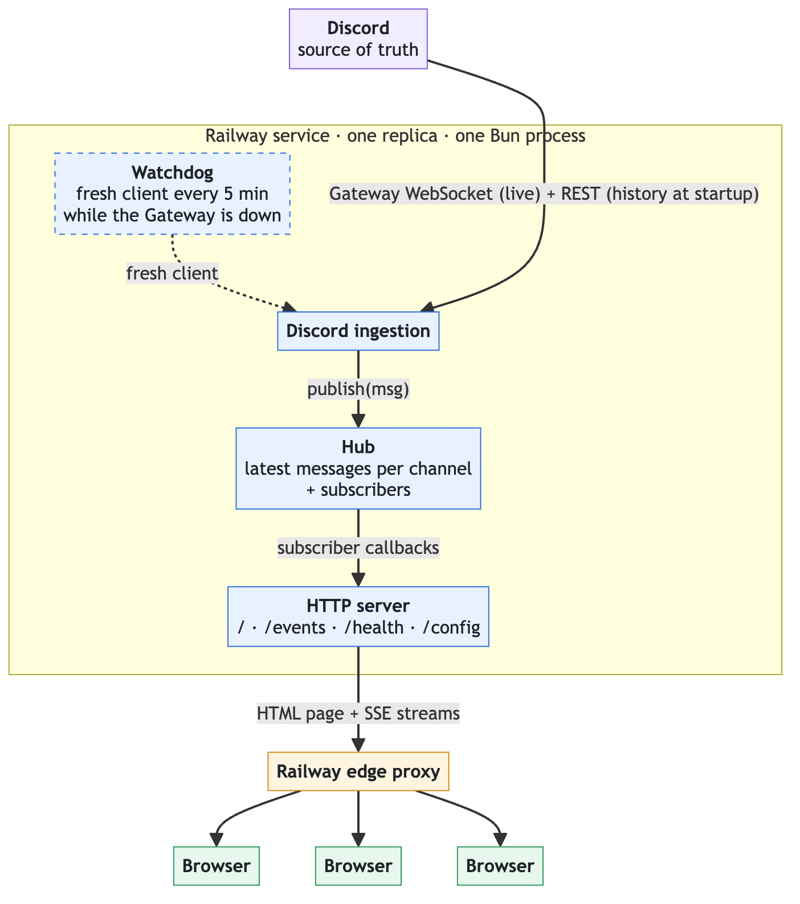

# DiscordRelay

A Discord bot that streams messages from one or more Discord channels into a web page in real time. 

Link: discord-relay-production-262e.up.railway.app

## Acronyms and Terminology

| Term | Meaning |
| --- | --- |
| Bun | JavaScript runtime with a built-in HTTP server, bundler and test runner. Runs the server, bundles the React page and runs the tests. |
| Gateway | Discord's real-time WebSocket API. The bot gets new and deleted messages through it. |
| Snowflake | Discord's message ID: unique and time-ordered. Used for ordering and dedupe. |
| MessageContent intent | Discord permission the bot needs to read message text. Without it, Discord closes the Gateway (code 4014). |
| SSE | Server-Sent Events: a one-way server-to-browser stream over plain HTTP, read with `EventSource`. Served on `GET /events`. |
| Pub/Sub | Publish/subscribe (Observer pattern): publishers send messages without knowing who receives them; subscribers get every message published. |
| Hub | The in-memory core (`backend/hub.ts`): the latest messages per channel plus Pub/Sub. The bot publishes, each open browser stream subscribes. |
| Edge | Railway's public proxy. Cuts requests at 15 min and caps in-flight requests per domain. |
| SIGTERM | The signal Railway sends to stop the process. The server closes open streams and the Discord client, then exits. |

## High Level Design

### How it works
One Railway service, with one replica, runs three components in a single Bun process:

- **Discord ingestion**: connects to Discord as a read-only bot, loads recent history over Discord's REST API at startup, and receives new messages live over the gateway, Discord's real-time WebSocket
- **Hub**: keeps the latest messages per channel in memory. Each open browser stream registers a callback; when a message arrives, the hub calls every callback for that channel
- **HTTP Server**: serves the web page, streams messages to browsers over SSE

### Components

| Component | What it does |
| --- | --- |
| Discord ingestion | Connects to the Gateway, loads recent history at startup, turns each Discord message into a `Msg` and publishes it to the hub. Replaces the client if the Gateway stays down for 5 minutes. |
| Hub | Keeps the latest messages per channel, sorted by ID, and drops duplicates. Calls each subscriber's callback when a message arrives or is deleted. |
| HTTP server | Serves the page, the SSE streams, `/health` and `/config`. Limits streams per IP, drops clients that stop reading and closes streams on SIGTERM. |
| Config | Reads and checks the env vars once at startup. Exits with a log line naming any bad variable. |
| Feature flags | Reads Railway Feature Flags. Every flag is off if Railway or the token is unavailable. |
| Frontend | Opens one `EventSource` for the selected channel, keeps up to 500 messages by ID, shows the connection status and reconnects on its own. |

### HTTP API

| Route | Returns |
| --- | --- |
| `GET /` | The React page, bundled by Bun. |
| `GET /events?channel=<id>&since=<id>` | An SSE stream: the Discord connection status, then the buffered messages (only those newer than `since`, if given), then live messages, deletes and a ping every 25 s. |
| `GET /config` | The feature flags and the list of channels with their names. |
| `GET /health` | 200 when the Gateway is connected, 503 otherwise. The body has `discord`, `clients`, `buffered`, `lastEventAt`, `unavailableChannels` and `uptimeSec`. |
