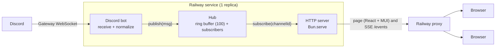
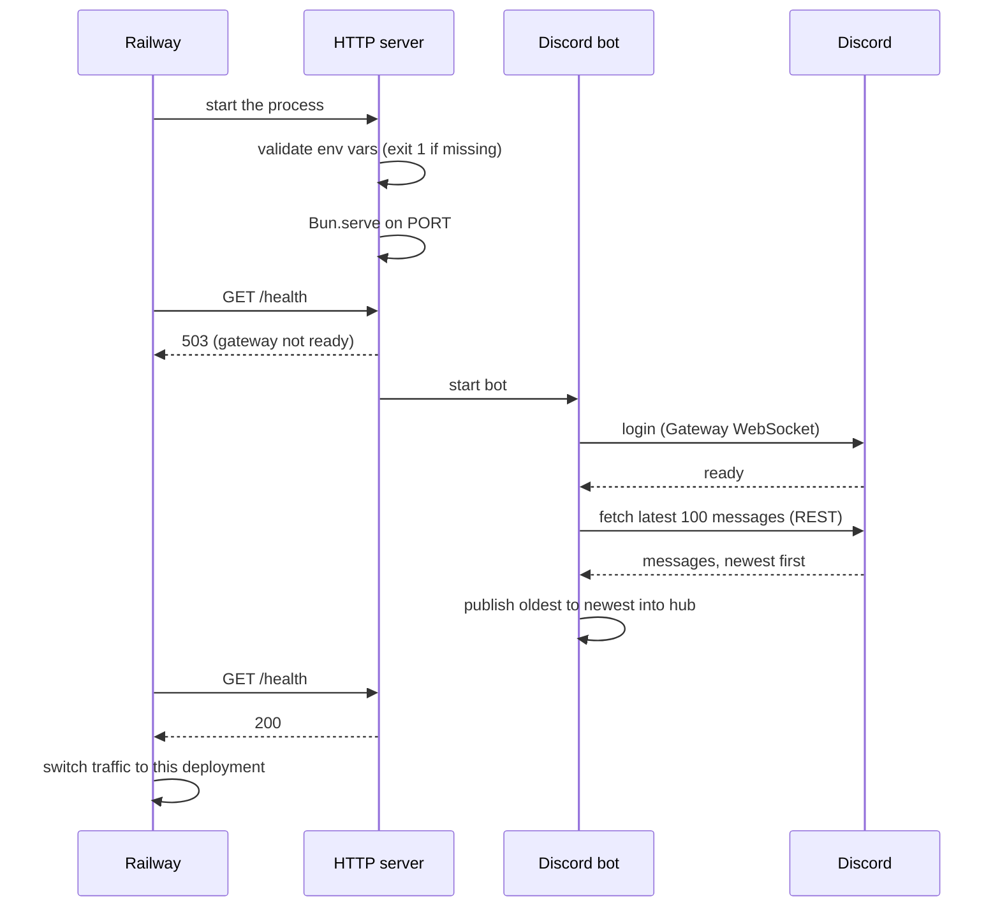
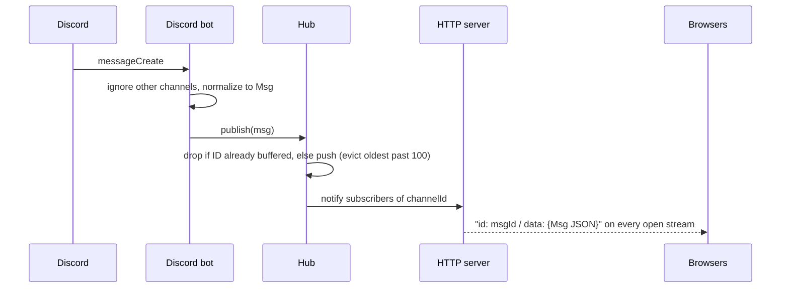
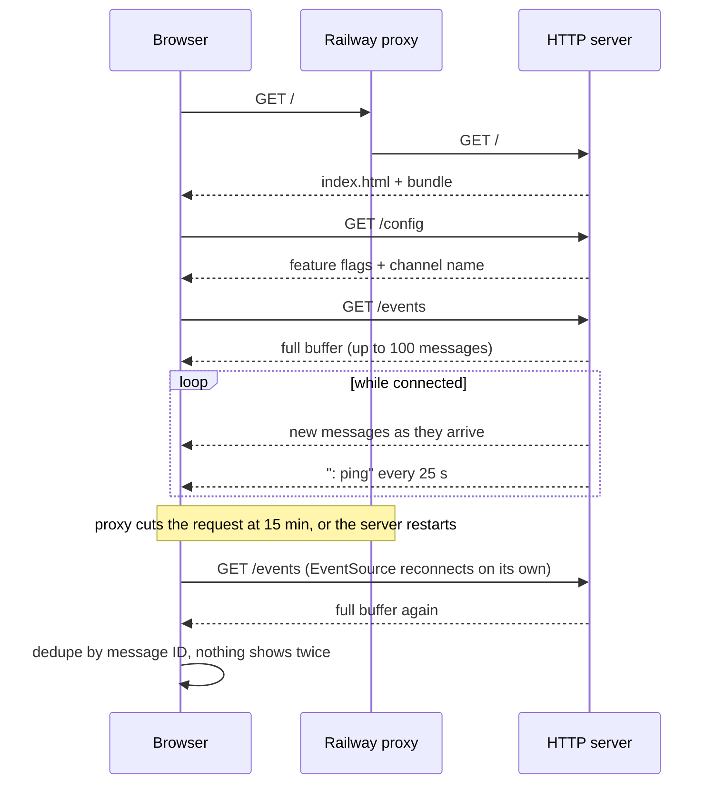
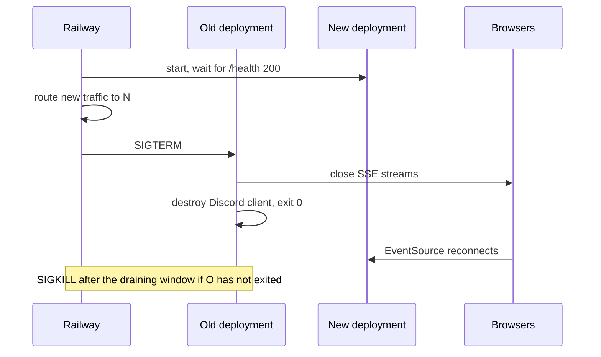

# Architecture

DiscordRelay streams messages from one Discord channel to a web page in real time. A single Bun process on Railway holds a Discord Gateway connection, keeps the latest messages in memory, and pushes them to browsers over Server-Sent Events (SSE). Discord is the source of truth, and the app stores nothing permanently.

## Block diagram



## Components

| Component | File | Responsibility |
|---|---|---|
| Discord bot | `backend/sources/discord.ts` | Connects to the Gateway, fetches history at startup, converts discord.js messages to `Msg`, and calls `publish`. It is the only file that imports discord.js. |
| Hub | `backend/hub.ts` | Holds a ring buffer of 100 messages per channel, dedupes by message ID, and handles publish/subscribe. Everything is keyed by `channelId`. Created with `createHub()`, so each test gets a fresh instance. |
| HTTP server | `backend/server.ts` | The entry point. Runs `Bun.serve` for the page, `/events`, `/health` and `/config`, reads env vars and flags once at startup, and handles SIGTERM. It is the only place dependencies are wired: it creates the hub and passes it, the config and the publish function to the bot and the routes. |
| Types | `backend/types.ts` | `Msg` and `Attachment`, shared with the frontend. |
| Frontend | `frontend/app.tsx` | React + MUI page. Opens one `EventSource`, keeps up to 500 messages keyed by ID, and shows connection status. |

## Patterns

The hub is the Observer pattern. Subscribers are plain callbacks of type `(m: Msg) => void` rather than classes with an `update()` method, because TypeScript functions are values. Each open `/events` stream subscribes one callback and removes it when the browser disconnects.

Dependencies are passed in as function arguments, with no DI framework. The HTTP server creates the hub and hands each module what it needs, so tests can pass a fresh hub and a fake source instead of a real Discord bot.

## Flows

### Startup

The HTTP server starts first so Railway's healthcheck can reach it. `/health` returns 503 until the Gateway is connected, so Railway does not send traffic to the new deployment before then.



### A new message



When `FEATURE_EDITS_DELETES` is on, an edit replaces the buffered message with the same ID and is sent again under that ID. A delete removes the message and sends a `delete` event.

### A browser connecting and reconnecting



### Shutdown during a deploy or restart



## HTTP API

| Route | Response |
|---|---|
| `GET /` | The React page. Bun bundles `frontend/` from the HTML import. Until the frontend task, a plain-text placeholder. |
| `GET /events` | `text/event-stream`. Sends the buffer, then live events, with `: ping` every 25 s. |
| `GET /config` | `{ "attachments": bool, "editsDeletes": bool, "debugPanel": bool, "channelName": string \| null }`. `channelName` is null until the bot has loaded the channel at startup. |
| `GET /health` | `200` when the Gateway is connected, `503` otherwise. Body: `{ "discord": "connected" \| "disconnected", "clients": n, "buffered": n, "lastEventAt": iso \| null, "uptimeSec": n }` |

SSE events (the stream opens with a `: connected` comment so headers reach the browser even when the buffer is empty):

```
: connected

id: 1301234567890123456
data: {"id":"1301234567890123456","channelId":"…","author":{…},"content":"hello",…}

event: delete
id: 1301234567890123456
data: {"id":"1301234567890123456","channelId":"…"}

: ping
```

The `id:` is always the Discord message ID. On reconnect the server ignores `Last-Event-ID` and resends the full buffer, which is safe because the browser dedupes by ID (see D7 in `decisions.md`).

## Message shape

A real example and a field-by-field table are in `message-shape.md`.

```ts
type Attachment = {
  url: string            // Discord CDN URL, signed, expires after ~24 h
  name: string
  contentType: string | null
}

type Msg = {
  id: string             // Discord message ID (snowflake, unique, time-ordered)
  channelId: string
  author: { id: string; name: string; avatarUrl: string | null; bot: boolean }
  content: string
  createdAt: string      // ISO 8601
  editedAt: string | null
  attachments: Attachment[]
}
```

## Configuration

| Variable | Required | Purpose |
|---|---|---|
| `DISCORD_TOKEN` | yes | Bot token, stored as a sealed Railway variable. |
| `CHANNEL_ID` | yes | Channel to relay. |
| `PORT` | injected | Set by Railway. |
| `FEATURE_ATTACHMENTS` | no (`false`) | Render images, video and file links. |
| `FEATURE_EDITS_DELETES` | no (`false`) | Update edited and deleted messages live. |
| `DEBUG_PANEL` | no (`false`) | Show Gateway status, client count and last event time on the page. |

The server reads flags once at startup. Changing one in Railway redeploys the service.

## Limits

| Limit | Value | Why |
|---|---|---|
| Server buffer per channel | 100 messages | Keeps memory bounded. It is also the most Discord returns in one history fetch. |
| History fetched at startup | 100 messages | Matches the buffer. |
| Browser message cap | 500 | Keeps a tab that stays open for days fast. |
| SSE heartbeat | 25 s | Railway closes requests that send no data for 5 min. |
| Gateway watchdog | Exit 1 after 5 min disconnected | Railway runs healthchecks only at deploy time. |
| Debug panel refresh | `/health` every 10 s | Diagnostics only. Messages are never polled. |

## Railway deployment

| Setting | Value |
|---|---|
| Services / replicas | 1 / 1 |
| Start command | `bun run backend/server.ts` |
| Healthcheck path | `/health` |
| Restart policy | On failure |
| App sleeping | Off |
| Deployment overlap / draining | 30 s / 30 s |
| Autodeploy | `main`, with "Wait for CI" |
| Watch paths | `backend/**`, `frontend/**`, `package.json`, `bun.lock`. Other changes do not deploy. |
| PR environments | Off |
| Config | `.railway/railway.ts` (Railway IaC) |

## Scope

Built:

- Live relay of one channel, with history at startup, reconnect and dedupe
- `FEATURE_ATTACHMENTS`, `FEATURE_EDITS_DELETES` and `DEBUG_PANEL`

Not built, and described in the README instead:

- A moderation filter. Discord AutoMod comes first; if that is not enough, a `filter()` runs before `hub.publish`.
- Loading older history
- Multiple channels in the UI, although the hub already keys by `channelId`
- Replicas, Redis, Postgres and a staging environment

## Extending

Supporting more channels means reading `CHANNEL_IDS` as a list and adding `/events?channel=ID`. The hub is already keyed by channel.

Relaying another source, such as a Slack channel, means adding `backend/sources/slack.ts`, which calls `publish`. Forwarding messages to Slack instead is one more subscriber: `hub.subscribe(msg => postToSlack(msg))`. Neither change touches the hub or the HTTP server.

Running more replicas means replacing the in-memory hub with a Redis-backed one that keeps the same `publish`/`subscribe` functions, and moving the bot into its own one-replica service (see D6 in `decisions.md`).
