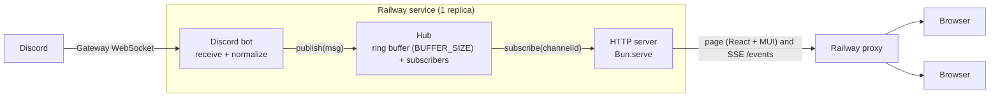
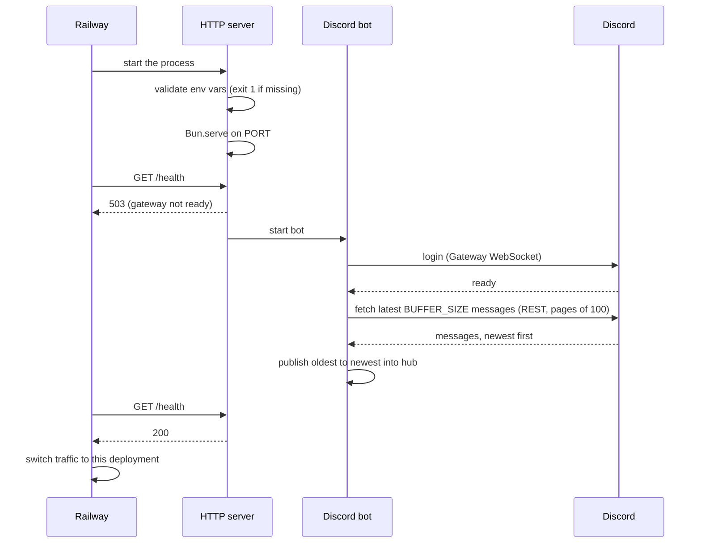
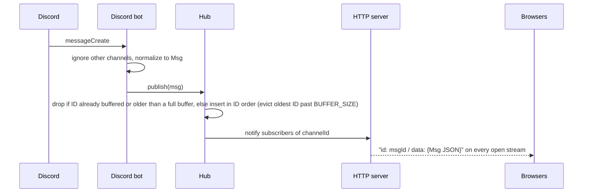
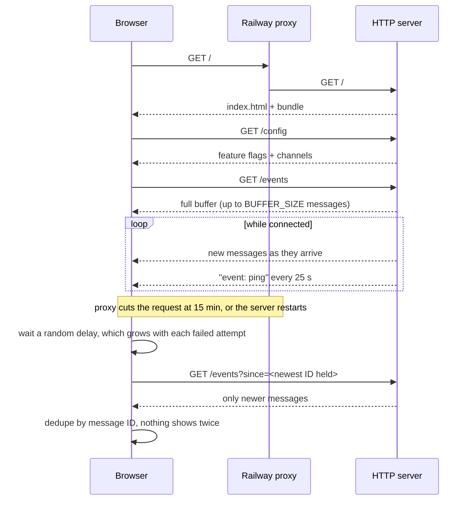
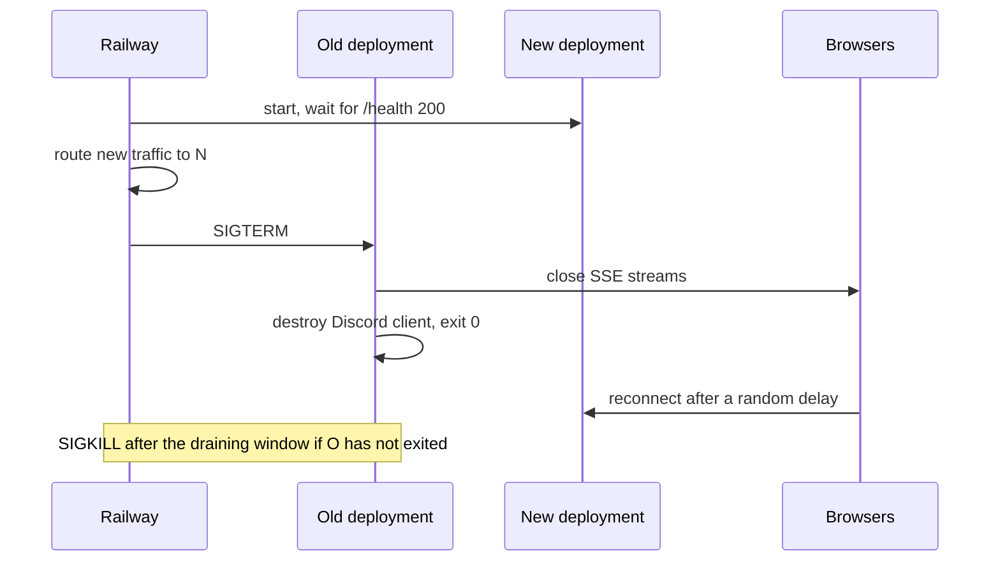

# Architecture

DiscordRelay streams messages from one Discord channel to a web page in real time. A single Bun process on Railway holds a Discord Gateway connection, keeps the latest messages in memory, and pushes them to browsers over Server-Sent Events (SSE). Discord is the source of truth, and the app stores nothing permanently.

## Block diagram



## Components

| Component | File | Responsibility |
|---|---|---|
| Discord bot | `backend/sources/discord.ts`, `discord-message.ts`, `watchdog.ts` | Connects to the Gateway, fetches history at startup, converts discord.js messages to `Msg`, and calls `publish`. It is the only file that imports discord.js. |
| Hub | `backend/core/hub.ts` | Holds a ring buffer of `BUFFER_SIZE` messages per channel, dedupes by message ID, and handles publish/subscribe. Everything is keyed by `channelId`. Created with `createHub()`, so each test gets a fresh instance. |
| Config | `backend/platform/config.ts` | Reads and validates env vars once at startup (`loadConfig`); exits naming the variable when one is missing or invalid. |
| Flags | `backend/platform/flags.ts` | Reads Railway Feature Flags through the `railway` SDK; every flag falls back to off. |
| HTTP server | `backend/server.ts`, `backend/http/sse.ts` | The entry point. Runs `Bun.serve` for the page, `/events`, `/health` and `/config`, and handles SIGTERM. It is the only place dependencies are wired: it creates the hub and passes it, the config and the publish function to the bot and the routes. |
| Types | `backend/core/types.ts` | `Msg` and `Attachment`, shared with the frontend. |
| Frontend | `frontend/` | React + MUI page, wired in `app.tsx`. `hooks/use-event-stream.ts` opens one `EventSource`, keeps up to 500 messages keyed by ID, and shows connection status. |

## Patterns

The hub is the Observer pattern. Subscribers are plain callbacks of type `(m: Msg) => void` rather than classes with an `update()` method, because TypeScript functions are values. Each open `/events` stream subscribes one callback and removes it when the browser disconnects.

Dependencies are passed in as function arguments, with no DI framework. The HTTP server creates the hub and hands each module what it needs, so tests can pass a fresh hub and a fake source instead of a real Discord bot.

## Flows

### Startup

The HTTP server starts first so Railway's healthcheck can reach it. `/health` returns 503 until the Gateway is connected, so Railway does not send traffic to the new deployment before then.



### A new message



When the `edits-deletes` flag is on, a delete removes the message from the buffer and sends `event: delete`. Messages deleted while the Gateway was down are found by comparing the next history reload with the buffer. With the flag off, a deleted message stays on the page until it leaves the buffer or the server restarts. Edits are planned behind the same flag.

### A browser connecting and reconnecting



### Shutdown during a deploy or restart



## HTTP API

| Route | Response |
|---|---|
| `GET /` | The React page. Bun bundles `frontend/` from the HTML import; `NODE_ENV=production` makes it a minified build with no hot reload. |
| `GET /events?channel=<id>` | `text/event-stream` for one channel. Opens with a `discord` event, then sends its buffer and live events, with `event: ping` every 25 s. `since=<id>` limits both to messages newer than that ID; an invalid value is ignored. No `channel` means the first configured channel; an ID that is not configured returns 404. Past 20 open streams from one IP it returns 429 with `Retry-After: 30`. A client more than 1 MiB behind on live writes is dropped. |
| `GET /config` | `{ "attachments": bool, "editsDeletes": bool, "channels": [{ "id": string, "name": string \| null }] }`. A `name` is null until the bot has loaded that channel at startup. |
| `GET /health` | `200` when the Gateway is connected, `503` otherwise. Body: `{ "discord": "connected" \| "disconnected", "clients": n, "buffered": n, "lastEventAt": iso \| null, "unavailableChannels": [id], "uptimeSec": n }` |

The stream opens with a `: connected` comment so headers reach the browser even when the buffer is empty. A named `discord` event (`data: connected`, `disconnected`, or `unavailable` when the bot cannot read this channel) follows it, and repeats within about a second whenever the Gateway state changes, so the page's chip reflects the bot and not only the browser's stream.

SSE events:

```
: connected

id: 1301234567890123456
data: {"id":"1301234567890123456","channelId":"…","author":{…},"content":"hello",…}

event: delete
data: {"id":"1301234567890123456","channelId":"…"}

event: ping
data: 1
```

The `id:` is always the Discord message ID. On reconnect the browser passes the newest ID it holds as `?since=` and gets only newer messages (see D7 in `decisions.md`), plus, with the `edits-deletes` flag on, a `delete` event for each of the last 500 deletions, whatever their age.

## Message shape

A real example and a field-by-field table are in `message-shape.md`.

```ts
type Attachment = {
  url: string            // Discord CDN URL, signed, expires after ~24 h
  name: string
  contentType: string | null
}

type Msg = {
  id: string             // Discord message ID (snowflake, unique, time-ordered)
  channelId: string
  author: { id: string; name: string; avatarUrl: string | null; bot: boolean }
  content: string
  note: string | null
  createdAt: string      // ISO 8601
  editedAt: string | null
  attachments: Attachment[]
}
```

## Configuration

| Variable | Required | Purpose |
|---|---|---|
| `DISCORD_TOKEN` | yes | Bot token, stored as a sealed Railway variable. |
| `CHANNEL_ID` | yes | Channel(s) to relay: one ID, or several comma-separated. |
| `BUFFER_SIZE` | no (`100`) | Messages kept per channel and loaded at startup, 1 to 500. |
| `LOG_LEVEL` | no | `debug` logs each client connecting and disconnecting in production. Off by default, because a deploy reconnecting every client would exceed Railway's log limit. |
| `PORT` | injected | Set by Railway. |
| `RAILWAY_TOKEN` | no | Project token for reading feature flags. Without it every flag is off. |
| `GRAFANA_METRICS_URL`, `GRAFANA_METRICS_USER`, `GRAFANA_METRICS_TOKEN` | no | Grafana Cloud push endpoint, instance ID and `metrics:write` token. With all three set, `backend/platform/metrics.ts` pushes `relay_*` metrics every 60 s; with none, nothing is pushed; with only some, startup fails naming the missing one. |

The server reads these once at startup; changing one in Railway redeploys the service.

Metrics are for the developer only: the app pushes one Influx line protocol line to Grafana Cloud every 60 s and serves no `/metrics` route. The series are `relay_gateway_connected`, `relay_sse_clients`, `relay_messages_total`, `relay_clients_dropped_total`, `relay_rejected_total` (429s), `relay_watchdog_restarts_total` and `relay_http_errors_total` (500s from a route that threw, logged as `request_failed`), tagged with `deployment` so two processes overlapping during a deploy never mix their totals. Drops, 429s, watchdog restarts and 500s are counted from their log events (`log.count`). A failed push logs `metrics_push_failed` and never affects the relay. The dashboard and alert rules live in `.grafana/apply.ts`; alerts go to a Discord contact point.

Feature flags are Railway Feature Flags, not variables: `attachments` and `edits-deletes` (both bool, default off). `backend/platform/flags.ts` reads them through the `railway` SDK, which polls Railway, and `/config` reads them on every request, so a change applies on the next page load without a redeploy.

## Limits

| Limit | Value | Why |
|---|---|---|
| Server buffer per channel | `BUFFER_SIZE`, default 100, 1 to 500 | Keeps memory bounded. A new page gets the whole buffer, and 500 matches the browser cap. |
| History fetched at startup | Same as the buffer | Fetched in pages of 100, the most Discord returns per request. |
| Browser message cap | 500 | Keeps a tab that stays open for days fast. |
| Open streams per client IP | 20, then 429 | Stops one machine holding thousands of subscriptions. The IP is the `X-Real-IP` header Railway sets. |
| Queued bytes per stream | 1 MiB, then the client is dropped | Stops a client that stopped reading from growing server memory. A replay may exceed it, since the buffer bounds it. |
| Reconnect delay | Random, up to 1 s, doubling per attempt to 30 s | Spreads browsers dropped together. Starts over once a stream has stayed open 30 s. |
| SSE heartbeat | 25 s | Railway closes requests that send no data for 5 min. |
| Gateway watchdog | Fresh client every 5 min while disconnected | Railway runs healthchecks only at deploy time. Exiting would lose the buffer and use up restarts. |

## Railway deployment

| Setting | Value |
|---|---|
| Services / replicas | 1 / 1 |
| Start command | `bun run backend/server.ts` |
| Healthcheck path | `/health` |
| Restart policy | On failure |
| App sleeping | Off |
| Deployment overlap / draining | 30 s / 30 s |
| Autodeploy | `main`, with "Wait for CI" |
| Watch paths | `backend/**`, `frontend/**`, `package.json`, `bun.lock`. Other changes do not deploy. |
| PR environments | Off |
| Config | `.railway/railway.ts` (Railway IaC) |

## Scope

Built:

- Live relay of one or more channels, with history at startup, reconnect and dedupe, and a tab per channel on the page
- the `attachments` flag

Planned: edits behind `edits-deletes`, which so far controls deletes only.

Not built, and described in the README instead:

- A moderation filter. Discord AutoMod comes first; if that is not enough, a `filter()` runs before `hub.publish`.
- Loading older history
- Replicas, Redis, Postgres and a staging environment

## Extending

Adding a channel is a config change: append its ID to `CHANNEL_ID` in Railway. The bot needs View Channel and Read Message History on it.

Relaying another source, such as a Slack channel, means adding `backend/sources/slack.ts`, which calls `publish`. Forwarding messages to Slack instead is one more subscriber: `hub.subscribe(msg => postToSlack(msg))`. Neither change touches the hub or the HTTP server.

Running more replicas means replacing the in-memory hub with a Redis-backed one that keeps the same `publish`/`subscribe` functions, and moving the bot into its own one-replica service (see D6 in `decisions.md`).
